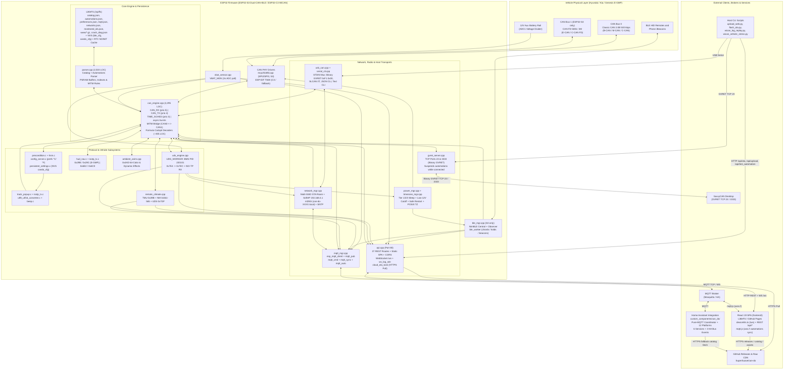

# CAN Do — Codebase Archaeology & Architecture Map

> **Ground Truth Basis**: Derived directly from live source code in `d:\Documents\can-do` (catalog & version `2026.11.7-b004`). Every subsystem boundary, route, topic, wire format, line number, and broken wire below reflects what the code **actually executes today**, not what comments or docs claim.

---

## 1. System Architecture & Data Flow

### 1.1 Runtime Architecture & Communication Topology

### 1.2 Directory & Root Artifact Responsibility Map

| Path                                                                                                   | Actual Responsibility Today                                                                                                                                                                                                                                                                                                                                                                                                                                                                                                                                                                                                                         |
| :----------------------------------------------------------------------------------------------------- | :-------------------------------------------------------------------------------------------------------------------------------------------------------------------------------------------------------------------------------------------------------------------------------------------------------------------------------------------------------------------------------------------------------------------------------------------------------------------------------------------------------------------------------------------------------------------------------------------------------------------------------------------------- |
| [`catalog/`](file:///d:/Documents/can-do/catalog/can_do_catalog.json)                                  | Stores canonical `can_do_catalog.json` (`v2026.11.7-b004`: 24 vehicles, 155 commands across 12 HA domains plus 1 domainless `ambient_light_brightness`, strictly 1-based `D1`–`D8`). Also contains gitignored local scratch script [`catalog/bulk_ingest_telemetry.py`](file:///d:/Documents/can-do/catalog/bulk_ingest_telemetry.py) pointing to a local decompilation path.                                                                                                                                                                                                                                                                       |
| [`firmware/`](file:///d:/Documents/can-do/firmware/CMakeLists.txt)                                     | ESP-IDF build root, 4 MB (`partitions.csv`: 2×1500 KB OTA + 960 KB LittleFS) and 8 MB (`partitions_8mb.csv`: 2×3072 KB OTA + 1984 KB LittleFS) tables, `sdkconfig.defaults` (C3) and `sdkconfig.defaults.esp32s3` (S3 + 2 MB PSRAM + NimBLE), `version.txt`, prebuilt CI binaries (`can-do-esp32c3.bin`, `can-do-esp32s3.bin`), untracked `can-do-esp32s3-merged.bin`, default [`firmware/automations.json`](file:///d:/Documents/can-do/firmware/automations.json) (`v2026.9.9`), and Python flashers [`upload_web.py`](file:///d:/Documents/can-do/firmware/upload_web.py) / [`flash_ota.py`](file:///d:/Documents/can-do/firmware/flash_ota.py). |
| [`firmware/data/`](file:///d:/Documents/can-do/firmware/data/preferences.json)                         | LittleFS (`storage` partition) staging tree: gzipped web bundle `www/*.gz` + `frontend_manifest.json`, default `automations.json`, `preferences.json`, gitignored local `mqtt.json` & `networks.json`, and gitignored minified `catalog.json` (regenerated by Vite `closeBundle` or `idf.py build`).                                                                                                                                                                                                                                                                                                                                                |
| [`firmware/main/`](file:///d:/Documents/can-do/firmware/main/main.cpp)                                 | Boot orchestrator [`main.cpp`](file:///d:/Documents/can-do/firmware/main/main.cpp) (PSRAM cJSON hooks, crash diagnostics persistence, LittleFS mount, NVS/Wi-Fi/mDNS/SNTP/BLE/CAN/HTTP/MQTT/GVRET/USB/UDS startup) and [`CMakeLists.txt`](file:///d:/Documents/can-do/firmware/main/CMakeLists.txt) (compiles **26** `.c`/`.cpp` sources and minifies the canonical catalog into `firmware/data/catalog.json`).                                                                                                                                                                                                                                     |
| [`firmware/main/core/`](file:///d:/Documents/can-do/firmware/main/core/can_engine.cpp)                 | Core CAN & automation spine: `can_engine.cpp` (4,295 LOC: RX/TX/sched tasks, automation matcher, MITM bridge, RTC NOINIT cache, plus ~305 LOC continuous formula cockpit decoders), `parser.cpp` (2,503 LOC: bounded PSRAM streaming catalog/automation compiler), `mcp2518fd.cpp` (899 LOC: dual SPI CAN FD driver; stamps `frame->bus` on RX and supports `dual_can_prepare_sleep()`), `types.h`, `can.h`, `board_pins.h`, `psram_alloc.h` (`PsramVector`/`PsramList`/`PsramUnorderedMap`/`PsramUnorderedSet`).                                                                                                                                                 |
| [`firmware/main/net/`](file:///d:/Documents/can-do/firmware/main/net/api.cpp)                          | All external I/O transports: `api.cpp` (3,966 LOC: HTTP/REST + `/ws` + static SPA + Cloud OTA), `mqtt_mgr.cpp` (2,398 LOC), `ble_mgr.cpp` (1,978 LOC), `network_mgr.cpp` (943 LOC; `esp_wifi_get_ps()` guard before `WIFI_PS_NONE` + `network_mgr_shutdown()`), `gvret_server.cpp` (594 LOC), `usb_can.cpp` (177 LOC), `serial_cli.cpp` (296 LOC), and `config_server.c` (126 LOC: loads cluster OSD °C/°F unit from `/spiffs/preferences.json`; button-binding getters remain static constants).                                                                                                                                                                 |
| [`firmware/main/platform/`](file:///d:/Documents/can-do/firmware/main/platform/power_mgr.cpp)          | Hardware/OS support: 12V ADC voltage monitor (`vbat_sensor.cpp`, with 10s stale-expiry & `vbat_sensor_is_fresh()` on CAN `0x1CF` fallback), Tier 1/2/3 sleep + sustained low-12V deep-sleep cutoff + safe restart (`power_mgr.cpp`, 314 LOC), POSIX TZ mapper (`timezone_mgr.cpp`), and NVS-backed `precon_en` persistence (`persistent_settings.c`, 133 LOC, namespace `cando_cfg`).                                                                                                                                                                                                                                                                                          |
| [`firmware/main/protocols/`](file:///d:/Documents/can-do/firmware/main/protocols/uds_engine.cpp)       | Diagnostic & framing helpers: UDS BMS poller (`uds_engine.cpp`, 811 LOC), ISO-TP multi-frame TX (`isotp_tx.c`), hierarchical state machine kernel (`hsm.c`), and UTF-8→UTF-16LE encoder (`utf8_utf16_converter.c`).                                                                                                                                                                                                                                                                                                                                                                                                                                                  |
| [`firmware/main/subsystems/`](file:///d:/Documents/can-do/firmware/main/subsystems/remote_climate.cpp) | Vehicle feature state machines: battery preconditioning HSM (`precondition.c`, 1,694 LOC), cluster OSD track popup (`track_popup.c`, 727 LOC, with clamped `hold_ms` `[1000, 15000]` ms support), HUD turn-by-turn nav (`hud_nav.c`), TMU remote climate keepalive (`remote_climate.cpp`), 64-color/effect ambient lighting (`ambient_anim.cpp`), and head-unit chime (`beep.c`).                                                                                                                                                                                                                                                                               |
| [`custom_components/can_do/`](file:///d:/Documents/can-do/custom_components/can_do/__init__.py)        | HACS Home Assistant integration (`v2026.11.7-b004`) communicating **exclusively via MQTT** (zero HTTP calls to ESP32): `coordinator.py` (848 LOC), `catalog_loader.py`, `config_flow.py`, `entity.py`, `can_utils.py`, 12 entity platforms, `services.yaml`, and gitignored local catalog cache `can_do_catalog.json`.                                                                                                                                                                                                                                                                                                                                                  |
| [`frontend/`](file:///d:/Documents/can-do/frontend/vite.config.ts)                                     | React 19 + Vite 6 + TypeScript + Tailwind 4 + HeroUI SPA (`v2026.11.7-b004`). `vite.config.ts` mocks several `/api/*` endpoints in dev and outputs pre-gzipped assets + `frontend_manifest.json` directly to `firmware/data/www/`.                                                                                                                                                                                                                                                                                                                                                                                                                                   |
| [`scripts/`](file:///d:/Documents/can-do/scripts/optimize_catalog.py)                                  | Catalog schema normalizer/validator (`optimize_catalog.py`, enforced in CI) and bench stress/replay harnesses (`wican_vehicle_stress.py`, `wican_log_replay.py`).                                                                                                                                                                                                                                                                                                                                                                                                                                                                                                       |
| [`tests/`](file:///d:/Documents/can-do/tests/test_remote_climate.py)                                   | 8-file Python `unittest` suite: `test_ha_control_and_sync.py` (1,399 LOC), `test_remote_climate.py` (1,112 LOC), `test_egmp_audit_decoders.py` (686 LOC), `test_can_utils.py` (392 LOC), `test_remaining_charge_time.py` (277 LOC), `test_catalog_loader.py` (268 LOC), `test_ev_charging_power.py` (235 LOC), `test_hud_nav_protocol.py` (218 LOC).                                                                                                                                                                                                                                                                                                               |
| [`docs/`](file:///d:/Documents/can-do/docs/architecture.md)                                            | Architecture specification (`architecture.md`), empirically verified E-GMP CAN/MICOM reference (`egmp_can_reference.md`), and setup/user guides.                                                                                                                                                                                                                                                                                                                                                                                                                                                                                                                        |
| [`.github/workflows/`](file:///d:/Documents/can-do/.github/workflows/firmware.yml)                     | CI/CD pipelines: `firmware.yml` (stamps versions, builds frontend + C3/S3 firmware, publishes GitHub Release, pushes `[skip ci]` sync to `main`), `deploy.yml` (GitHub Pages deploy of `frontend/dist` + `.bin` copies), `validate_catalog.yml` (catalog lint + Python `unittest`).                                                                                                                                                                                                                                                                                                                                                                                     |
| Root Files                                                                                             | Monorepo [`package.json`](file:///d:/Documents/can-do/package.json) + `bun.lock`, [`hacs.json`](file:///d:/Documents/can-do/hacs.json), gitignored IDE MCP stdio-to-TCP proxy [`savvylens_bridge.py`](file:///d:/Documents/can-do/savvylens_bridge.py) (unrelated to ESP32/GVRET), gitignored merged binaries (`can-do-atom-bridge-merged.bin`, `can-do-esp32c3-merged.bin`), and orphaned root `__pycache__/*.pyc` from deleted scripts.                                                                                                                                                                                                                             |

---

## 2. The Wiring & Contract Table

### 2A. HTTP REST & Static Endpoints (`firmware/main/net/api.cpp`, Port 80)

> [`start_webserver()`](file:///d:/Documents/can-do/firmware/main/net/api.cpp#L3868-L3965) registers **40 URI handlers** (`max_uri_handlers = 48`): **37 REST routes** (`L3896-L3932`) + `/ws` (`L3933`) + `/*` OPTIONS (`L3934`) + `/*` GET static SPA (`L3935`).

| Endpoint                             | Producer (Caller)                                                                                                                                                                                                                                                                                                                                      | Consumer (Firmware Handler)                                                                                           | Payload Shape (Req → Resp)                                                                                                                                                                                                                                                                                                                                                                                                                                                                  |
| :----------------------------------- | :----------------------------------------------------------------------------------------------------------------------------------------------------------------------------------------------------------------------------------------------------------------------------------------------------------------------------------------------------- | :-------------------------------------------------------------------------------------------------------------------- | :------------------------------------------------------------------------------------------------------------------------------------------------------------------------------------------------------------------------------------------------------------------------------------------------------------------------------------------------------------------------------------------------------------------------------------------------------------------------------------------ |
| `GET /api/states`                    | [`VehicleDashboard.tsx:1074`](file:///d:/Documents/can-do/frontend/src/components/VehicleDashboard.tsx#L1074) (mount/reconnect + 3s fallback poll only while WS disconnected), [`AutomationBuilder.tsx:872`](file:///d:/Documents/can-do/frontend/src/components/AutomationBuilder.tsx#L872), `wican_vehicle_stress.py`                                | [`api.cpp:605`](file:///d:/Documents/can-do/firmware/main/net/api.cpp#L605) (`api_states_handler`)                    | `→ [{"entity":str,"state":str}, ...]` (**Array**; appends `cond_aux_12v_battery` ADC fallback; Vite dev mock at [`vite.config.ts:269`](file:///d:/Documents/can-do/frontend/vite.config.ts#L269) matches `[]`)                                                                                                                                                                                                                                                                              |
| `POST /api/command`                  | [`VehicleDashboard.tsx:733`](file:///d:/Documents/can-do/frontend/src/components/VehicleDashboard.tsx#L733), [`AutomationBuilder.tsx:1411-1603`](file:///d:/Documents/can-do/frontend/src/components/AutomationBuilder.tsx#L1411-L1603), `wican_vehicle_stress.py`                                                                                     | [`api.cpp:660`](file:///d:/Documents/can-do/firmware/main/net/api.cpp#L660) (`api_command_handler`)                   | `{entity,command?,mode?,action?}` (forwards top-level `mode`/`action` as JSON for `battery_preconditioning`) OR `{can_id,steps:[...],bus,delay_ms}` OR `{can_id,payload,repeat,delay_ms,bus}` (accepts hex strings or numeric `0..255` `{D1..D8}` values) `→ {"status":"queued"}` (max 8 KB; Vite dev mock at [`vite.config.ts:236`](file:///d:/Documents/can-do/frontend/vite.config.ts#L236) returns `{"status":"queued"}`)                                                               |
| `POST /api/notify`                   | [`AutomationBuilder.tsx:1198`](file:///d:/Documents/can-do/frontend/src/components/AutomationBuilder.tsx#L1198), `wican_vehicle_stress.py`                                                                                                                                                                                                             | [`api.cpp:3394`](file:///d:/Documents/can-do/firmware/main/net/api.cpp#L3394) (`api_notify_handler`)                  | `{message\|text\|popup_message, level?:"info"\|"warning"\|"error"\|"critical", hold_ms?} → {"status":"ok",...}` (`hold_ms` clamped `[1000, 15000]` ms via `track_popup_show_*_ex()`; ignores `title`/`caller`/`type`; Vite dev mock at [`vite.config.ts:295`](file:///d:/Documents/can-do/frontend/vite.config.ts#L295))                                                                                                                                                                |
| `POST /api/nav`                      | [`AutomationBuilder.tsx:1247`](file:///d:/Documents/can-do/frontend/src/components/AutomationBuilder.tsx#L1247), `wican_vehicle_stress.py`                                                                                                                                                                                                             | [`api.cpp:3455`](file:///d:/Documents/can-do/firmware/main/net/api.cpp#L3455) (`api_nav_handler`)                     | `{action:"update"\|"clear", icon, direction\|direction_deg\|heading, distance\|distance_meters, bars, speed_limit, camera_alert, street, lanes\|num_lanes (clamped 0..8), lane_directions[], lane_recommended\|lane_highlights[], platform?:"gen2"\|"egmp"} → {"status":"ok",...}` (derives `num_lanes` from `lane_recommended` when omitted; clamps negative/non-finite numeric fields; Vite dev mock at [`vite.config.ts:244`](file:///d:/Documents/can-do/frontend/vite.config.ts#L244)) |
| `POST /api/test_automation`          | [`wican_vehicle_stress.py:379`](file:///d:/Documents/can-do/scripts/wican_vehicle_stress.py#L379)                                                                                                                                                                                                                                                      | [`api.cpp:1009`](file:///d:/Documents/can-do/firmware/main/net/api.cpp#L1009) (`api_test_automation_handler`)         | `{id, mode:"dry_run"\|"live_fire"\|"run_actions", actions?:[...]} → {status, passed?, message}` (alias of `/api/automations/test`)                                                                                                                                                                                                                                                                                                                                                          |
| `POST /api/automations/test`         | [`AutomationBuilder.tsx:1689,1747`](file:///d:/Documents/can-do/frontend/src/components/AutomationBuilder.tsx#L1689-L1751)                                                                                                                                                                                                                             | [`api.cpp:1009`](file:///d:/Documents/can-do/firmware/main/net/api.cpp#L1009) (`api_test_automation_handler`)         | Same as above (max 16 KB; formats non-CAN & `AND`/`OR`/`NOT` condition failures explicitly; Vite dev mock at [`vite.config.ts:184`](file:///d:/Documents/can-do/frontend/vite.config.ts#L184))                                                                                                                                                                                                                                                                                              |
| `GET /api/automations/diagnostics`   | [`DeviceDashboard.tsx:516`](file:///d:/Documents/can-do/frontend/src/components/DeviceDashboard.tsx#L516)                                                                                                                                                                                                                                              | [`api.cpp:1122`](file:///d:/Documents/can-do/firmware/main/net/api.cpp#L1122) (`api_automations_diagnostics_handler`) | `→ {automations_enabled, rules:[{id,name,enabled,ha_expose,triggers[],conditions[],actions[],...}]}` (serializes all ops incl. `<=`/`>=`, evaluates `trig.op`, handles non-CAN & `AND`/`OR`/`NOT` groups, standardizes `entity_id` on `ENTITY_COMMAND` & `CYCLE_ENTITY`)                                                                                                                                                                                                                    |
| `GET /api/automations`               | [`App.tsx:1113`](file:///d:/Documents/can-do/frontend/src/App.tsx#L1113), [`AutomationBuilder.tsx:2187`](file:///d:/Documents/can-do/frontend/src/components/AutomationBuilder.tsx#L2187)                                                                                                                                                              | [`api.cpp:2313`](file:///d:/Documents/can-do/firmware/main/net/api.cpp#L2313) (`api_get_automations_handler`)         | `→ /spiffs/automations.json` raw JSON (fallback `{settings:{...}, rules:[]}`; Vite dev mock at [`vite.config.ts:133`](file:///d:/Documents/can-do/frontend/vite.config.ts#L133))                                                                                                                                                                                                                                                                                                            |
| `POST /api/automations`              | [`App.tsx:1084`](file:///d:/Documents/can-do/frontend/src/App.tsx#L1084), [`AutomationBuilder.tsx:2094`](file:///d:/Documents/can-do/frontend/src/components/AutomationBuilder.tsx#L2094)                                                                                                                                                              | [`api.cpp:2351`](file:///d:/Documents/can-do/firmware/main/net/api.cpp#L2351) (`api_post_automations_handler`)        | Minified `automations.json` (client-validated & capped at 128 KB with 10s timeout) → JSON-validated atomic `.tmp` rename, reloads engine + triggers MQTT automation sync (Vite dev mock at [`vite.config.ts:133`](file:///d:/Documents/can-do/frontend/vite.config.ts#L133))                                                                                                                                                                                                                |
| `GET /api/preferences`               | [`settings.ts:101`](file:///d:/Documents/can-do/frontend/src/types/settings.ts#L101)                                                                                                                                                                                                                                                                   | [`api.cpp:2455`](file:///d:/Documents/can-do/firmware/main/net/api.cpp#L2455) (`api_get_preferences_handler`)         | `→ /spiffs/preferences.json` raw JSON (fallback `{}`)                                                                                                                                                                                                                                                                                                                                                                                                                                       |
| `POST /api/preferences`              | [`settings.ts:135`](file:///d:/Documents/can-do/frontend/src/types/settings.ts#L135)                                                                                                                                                                                                                                                                   | [`api.cpp:2488`](file:///d:/Documents/can-do/firmware/main/net/api.cpp#L2488) (`api_post_preferences_handler`)        | JSON prefs (max 8 KB) → merges incoming keys into existing `/spiffs/preferences.json` via atomic `.tmp` rename (preserving firmware-only keys like `uds_enabled`), reloads `uds_engine`, `can_engine`, `timezone_mgr`, `config_server`, `power_mgr`                                                                                                                                                                                                                                           |
| `GET /api/system/status`             | [`DeviceDashboard.tsx:329,473`](file:///d:/Documents/can-do/frontend/src/components/DeviceDashboard.tsx#L473), [`DeviceRebootModal.tsx:121`](file:///d:/Documents/can-do/frontend/src/components/DeviceRebootModal.tsx#L121), [`updateService.ts:416`](file:///d:/Documents/can-do/frontend/src/services/updateService.ts#L416), `wican_log_replay.py` | [`api.cpp:2641`](file:///d:/Documents/can-do/firmware/main/net/api.cpp#L2641) (`api_system_status_handler`)           | `→ {status, target, device, can_do_version, catalog_version, device_id, power_tier, low_vbat_cutoff_volts, uptime_sec, free_heap, min_free_heap, internal_free_heap, psram_free_heap, storage_*, vbat_volts, automations_enabled, sniffer_mode, hardware_listen_only, mitm_bridge_enabled, twai_state, can0_*, can1_*, gvret_*, time_synced, system_time, reset_reason, wakeup_cause, last_crash?, persisted_crash?}`                                                                     |
| `POST /api/system/control`           | [`DeviceDashboard.tsx:427,704-771`](file:///d:/Documents/can-do/frontend/src/components/DeviceDashboard.tsx#L704-L771), [`updateService.ts:482,500,629,875`](file:///d:/Documents/can-do/frontend/src/services/updateService.ts#L482-L504), `upload_web.py:293`                                                                                        | [`api.cpp:2900`](file:///d:/Documents/can-do/firmware/main/net/api.cpp#L2900) (`api_system_control_handler`)          | `{action:"restart"\|"reboot"\|"list_files"\|"clean_stale_web"\|"clean_www"\|"reload_catalog"\|"toggle_automations"\|"toggle_sniffer"\|"set_hardware_listen_only"\|"toggle_mitm_bridge"\|"disconnect_gvret"\|"reset_gvret", keep?, enabled?, automations_enabled?, sniffer_mode?, hardware_listen_only?, mitm_bridge_enabled?, reboot?}`                                                                                                                                                     |
| `POST /api/system/time`              | [`DeviceDashboard.tsx:793,2701`](file:///d:/Documents/can-do/frontend/src/components/DeviceDashboard.tsx#L793)                                                                                                                                                                                                                                         | [`api.cpp:2825`](file:///d:/Documents/can-do/firmware/main/net/api.cpp#L2825) (`api_system_set_time_handler`)         | `{epoch:number (>=1704067200), timezone?:string} → {"status":"success",...}` + emits WS `state/system_time`                                                                                                                                                                                                                                                                                                                                                                                 |
| `GET /api/wifi/status`               | [`DeviceDashboard.tsx:491`](file:///d:/Documents/can-do/frontend/src/components/DeviceDashboard.tsx#L491), [`AutomationBuilder.tsx:899`](file:///d:/Documents/can-do/frontend/src/components/AutomationBuilder.tsx#L899)                                                                                                                               | [`api.cpp:3071`](file:///d:/Documents/can-do/firmware/main/net/api.cpp#L3071) (`api_wifi_status_handler`)             | `→ {sta_connected, sta_ssid, sta_ip, sta_gw, sta_mask, sta_rssi, ap_active, ap_ssid, ap_ip, ap_clients, ap_mode:"auto"\|"always_on"\|"disabled"}` (`DeviceDashboard.tsx:115` `WifiStatus.ap_mode` aligned; `AutomationBuilder.tsx` maps `ap_active` via `mapWifi()`; Vite dev mock at [`vite.config.ts:216`](file:///d:/Documents/can-do/frontend/vite.config.ts#L216))                                                                                                                     |
| `GET /api/wifi/networks`             | [`DeviceDashboard.tsx:502`](file:///d:/Documents/can-do/frontend/src/components/DeviceDashboard.tsx#L502)                                                                                                                                                                                                                                              | [`api.cpp:3095`](file:///d:/Documents/can-do/firmware/main/net/api.cpp#L3095) (`api_wifi_get_networks_handler`)       | `→ [{ssid, priority}, ...]` (JSON array)                                                                                                                                                                                                                                                                                                                                                                                                                                                    |
| `POST /api/wifi/networks`            | [`DeviceDashboard.tsx:830`](file:///d:/Documents/can-do/frontend/src/components/DeviceDashboard.tsx#L830), fallback SoftAP HTML [`api.cpp:459`](file:///d:/Documents/can-do/firmware/main/net/api.cpp#L459)                                                                                                                                            | [`api.cpp:3108`](file:///d:/Documents/can-do/firmware/main/net/api.cpp#L3108) (`api_wifi_post_networks_handler`)      | `{ssid, password?, priority?} → {"status":"ok","message":"Network saved"}`                                                                                                                                                                                                                                                                                                                                                                                                                  |
| `DELETE /api/wifi/networks`          | [`DeviceDashboard.tsx:853`](file:///d:/Documents/can-do/frontend/src/components/DeviceDashboard.tsx#L853)                                                                                                                                                                                                                                              | [`api.cpp:3168`](file:///d:/Documents/can-do/firmware/main/net/api.cpp#L3168) (`api_wifi_delete_networks_handler`)    | Body `{ssid}` or query `?ssid=... → {"status":"ok"}` or `404`                                                                                                                                                                                                                                                                                                                                                                                                                               |
| `GET /api/wifi/scan`                 | [`DeviceDashboard.tsx:813`](file:///d:/Documents/can-do/frontend/src/components/DeviceDashboard.tsx#L813)                                                                                                                                                                                                                                              | [`api.cpp:3220`](file:///d:/Documents/can-do/firmware/main/net/api.cpp#L3220) (`api_wifi_scan_handler`)               | Fires async scan, immediately returns `{scanning:bool, results:[{ssid,rssi,authmode,in_known_list},...]}` (safe in `APSTA` mode; `WIFI_EVENT_SCAN_DONE` harvests scan results even while STA or SoftAP clients are connected)                                                                                                                                                                                                                                                               |
| `GET /api/ble/status`                | [`BluetoothManager.tsx:75`](file:///d:/Documents/can-do/frontend/src/components/BluetoothManager.tsx#L75), [`BleSelects.tsx:33`](file:///d:/Documents/can-do/frontend/src/components/BleSelects.tsx#L33), [`AutomationBuilder.tsx:917`](file:///d:/Documents/can-do/frontend/src/components/AutomationBuilder.tsx#L917)                                | [`api.cpp:3694`](file:///d:/Documents/can-do/firmware/main/net/api.cpp#L3694) (`api_ble_status_handler`)              | `→ {enabled, scanning, connected, connected_device, paired_devices[], discovered_devices[], last_event, recent_events[], beacon_targets[], discovered_beacons[]}` (`AutomationBuilder.tsx` rebuilds its BLE map from scratch on each poll incl. `major`/`minor`; Vite dev mock at [`vite.config.ts:277`](file:///d:/Documents/can-do/frontend/vite.config.ts#L277))                                                                                                                         |
| `POST /api/ble/scan`                 | [`BluetoothManager.tsx:179`](file:///d:/Documents/can-do/frontend/src/components/BluetoothManager.tsx#L179)                                                                                                                                                                                                                                            | [`api.cpp:3702`](file:///d:/Documents/can-do/firmware/main/net/api.cpp#L3702) (`api_ble_scan_handler`)                | Query `?duration=1..60 → {"status":"scanning_started"}`                                                                                                                                                                                                                                                                                                                                                                                                                                     |
| `POST /api/ble/pair`                 | [`BluetoothManager.tsx:210`](file:///d:/Documents/can-do/frontend/src/components/BluetoothManager.tsx#L210)                                                                                                                                                                                                                                            | [`api.cpp:3719`](file:///d:/Documents/can-do/firmware/main/net/api.cpp#L3719) (`api_ble_pair_handler`)                | `{mac\|address, name?} → {"status":"pairing_requested"}` (`400 Bad Request` on missing/empty address; `ble_mgr_pair_device()` validates & normalizes `AA-BB-CC-DD-EE-FF` or 12 hex → `AA:BB:CC:DD:EE:FF`)                                                                                                                                                                                                                                                                                   |
| `POST /api/ble/unpair`               | [`BluetoothManager.tsx:232`](file:///d:/Documents/can-do/frontend/src/components/BluetoothManager.tsx#L232)                                                                                                                                                                                                                                            | [`api.cpp:3747`](file:///d:/Documents/can-do/firmware/main/net/api.cpp#L3747) (`api_ble_unpair_handler`)              | `{mac?\|address?} → {"status":"ok"}` (`ble_mgr_unpair_device()` validates & normalizes non-empty MAC)                                                                                                                                                                                                                                                                                                                                                                                       |
| `POST /api/ble/test_event`           | [`BluetoothManager.tsx:262`](file:///d:/Documents/can-do/frontend/src/components/BluetoothManager.tsx#L262), `wican_vehicle_stress.py`                                                                                                                                                                                                                 | [`api.cpp:3772`](file:///d:/Documents/can-do/firmware/main/net/api.cpp#L3772) (`api_ble_test_event_handler`)          | `{button, action} → {"status":"ok"}`                                                                                                                                                                                                                                                                                                                                                                                                                                                        |
| `POST /api/ble/clear_events`         | [`BluetoothManager.tsx:284`](file:///d:/Documents/can-do/frontend/src/components/BluetoothManager.tsx#L284)                                                                                                                                                                                                                                            | [`api.cpp:3797`](file:///d:/Documents/can-do/firmware/main/net/api.cpp#L3797) (`api_ble_clear_events_handler`)        | `{} → {"status":"ok"}`                                                                                                                                                                                                                                                                                                                                                                                                                                                                      |
| `POST /api/ble/beacons`              | [`BluetoothManager.tsx:319,361`](file:///d:/Documents/can-do/frontend/src/components/BluetoothManager.tsx#L319)                                                                                                                                                                                                                                        | [`api.cpp:3805`](file:///d:/Documents/can-do/firmware/main/net/api.cpp#L3805) (`api_ble_beacons_post_handler`)        | `{uuid, mac\|address, name, enter_rssi, exit_timeout_s\|exit_timeout} → {"status":"ok"}` (`ble_mgr_set_beacon()` validates/normalizes UUID `8-4-4-4-12` uppercase hex & MAC, clamps `enter_rssi` `[-100,-25]` & `exit_timeout_s` `[5,600]`; `400 Bad Request` on invalid input)                                                                                                                                                                                                             |
| `DELETE /api/ble/beacons`            | [`BluetoothManager.tsx:340`](file:///d:/Documents/can-do/frontend/src/components/BluetoothManager.tsx#L340)                                                                                                                                                                                                                                            | [`api.cpp:3840`](file:///d:/Documents/can-do/firmware/main/net/api.cpp#L3840) (`api_ble_beacons_delete_handler`)      | `{uuid, mac\|address} → {"status":"ok"}` (`ble_mgr_delete_beacon()` validates/normalizes UUID & MAC; `400 Bad Request` on invalid input)                                                                                                                                                                                                                                                                                                                                                    |
| `GET /api/mqtt`                      | [`DeviceDashboard.tsx:533`](file:///d:/Documents/can-do/frontend/src/components/DeviceDashboard.tsx#L533)                                                                                                                                                                                                                                              | [`api.cpp:3243`](file:///d:/Documents/can-do/firmware/main/net/api.cpp#L3243) (`api_mqtt_get_handler`)                | `→ {enabled, ha_discovery, broker_url, username, has_password, connected}`                                                                                                                                                                                                                                                                                                                                                                                                                  |
| `POST /api/mqtt`                     | [`DeviceDashboard.tsx:570`](file:///d:/Documents/can-do/frontend/src/components/DeviceDashboard.tsx#L570)                                                                                                                                                                                                                                              | [`api.cpp:3257`](file:///d:/Documents/can-do/firmware/main/net/api.cpp#L3257) (`api_mqtt_post_handler`)               | `{enabled, ha_discovery, broker_url, username, password?, keep_password?} → {"status":"ok"}`                                                                                                                                                                                                                                                                                                                                                                                                |
| `GET /api/can/monitored_ids`         | [`DeviceDashboard.tsx:600`](file:///d:/Documents/can-do/frontend/src/components/DeviceDashboard.tsx#L600)                                                                                                                                                                                                                                              | [`api.cpp:3310`](file:///d:/Documents/can-do/firmware/main/net/api.cpp#L3310) (`api_can_monitored_ids_get_handler`)   | `→ {customized:bool, monitored_ids:["0x...",...]}`                                                                                                                                                                                                                                                                                                                                                                                                                                          |
| `POST /api/can/monitored_ids`        | [`DeviceDashboard.tsx:621`](file:///d:/Documents/can-do/frontend/src/components/DeviceDashboard.tsx#L621)                                                                                                                                                                                                                                              | [`api.cpp:3326`](file:///d:/Documents/can-do/firmware/main/net/api.cpp#L3326) (`api_can_monitored_ids_post_handler`)  | `{monitored_ids:["0x...",...]} → {"status":"ok","count":N}` (persists `/spiffs/monitored_ids.json`)                                                                                                                                                                                                                                                                                                                                                                                         |
| `POST /api/can/monitored_ids/reset`  | [`DeviceDashboard.tsx:639`](file:///d:/Documents/can-do/frontend/src/components/DeviceDashboard.tsx#L639)                                                                                                                                                                                                                                              | [`api.cpp:3371`](file:///d:/Documents/can-do/firmware/main/net/api.cpp#L3371) (`api_can_monitored_ids_reset_handler`) | `{} → {"status":"ok",...}` (unlinks `/spiffs/monitored_ids.json`, restores default monitored IDs)                                                                                                                                                                                                                                                                                                                                                                                           |
| `GET /api/can/active_ids`            | [`DeviceDashboard.tsx:601`](file:///d:/Documents/can-do/frontend/src/components/DeviceDashboard.tsx#L601)                                                                                                                                                                                                                                              | [`api.cpp:3379`](file:///d:/Documents/can-do/firmware/main/net/api.cpp#L3379) (`api_can_active_ids_get_handler`)      | `→ {"count":N, "active_ids":["0x038", ...]}`                                                                                                                                                                                                                                                                                                                                                                                                                                                |
| `POST /api/upload`                   | [`updateService.ts:308,337`](file:///d:/Documents/can-do/frontend/src/services/updateService.ts#L308-L341), [`upload_web.py:18,27,344`](file:///d:/Documents/can-do/firmware/upload_web.py#L18-L345)                                                                                                                                                   | [`api.cpp:1728`](file:///d:/Documents/can-do/firmware/main/net/api.cpp#L1728) (`api_file_upload_handler`)             | Headers `X-File-Path: /spiffs/...`, optional `X-No-Reboot: 1`. Raw bytes via atomic `.tmp` + LittleFS free-space check (0-byte deletes; `/spiffs/preferences.json` reloads `uds_engine`/`can_engine`/`timezone_mgr`/`config_server`/`power_mgr`; `/spiffs/catalog.json` reboots unless `X-No-Reboot: 1`).                                                                                                                                                                                     |
| `POST /api/ota`                      | [`DeviceDashboard.tsx:881`](file:///d:/Documents/can-do/frontend/src/components/DeviceDashboard.tsx#L881), [`updateService.ts:358`](file:///d:/Documents/can-do/frontend/src/services/updateService.ts#L358), [`flash_ota.py:21`](file:///d:/Documents/can-do/firmware/flash_ota.py#L21)                                                               | [`api.cpp:1920`](file:///d:/Documents/can-do/firmware/main/net/api.cpp#L1920) (`api_ota_handler`)                     | Raw ESP32 app `.bin` stream → writes OTA partition (`409` Conflict if OTA already active), tracks `g_ota_state`, schedules reboot                                                                                                                                                                                                                                                                                                                                                           |
| `POST /api/ota/cloud_pull`           | [`updateService.ts:813`](file:///d:/Documents/can-do/frontend/src/services/updateService.ts#L813)                                                                                                                                                                                                                                                      | [`api.cpp:2232`](file:///d:/Documents/can-do/firmware/main/net/api.cpp#L2232) (`api_ota_cloud_pull_handler`)          | `{url:"https://..."\|"http://..."} → {"status":"started"}` (validates `http://`/`https://` scheme before spawning `cloud_ota_task`)                                                                                                                                                                                                                                                                                                                                                         |
| `GET /api/ota/status`                | [`updateService.ts:834`](file:///d:/Documents/can-do/frontend/src/services/updateService.ts#L834)                                                                                                                                                                                                                                                      | [`api.cpp:2300`](file:///d:/Documents/can-do/firmware/main/net/api.cpp#L2300) (`api_ota_status_handler`)              | `→ {in_progress:bool, progress:0-100, bytes:int, success:bool, error:str}`                                                                                                                                                                                                                                                                                                                                                                                                                  |
| `OPTIONS /*`                         | Browser CORS preflights                                                                                                                                                                                                                                                                                                                                | [`api.cpp:522`](file:///d:/Documents/can-do/firmware/main/net/api.cpp#L522) (`options_handler`)                       | `204 No Content` with `Access-Control-Allow-Origin: *`                                                                                                                                                                                                                                                                                                                                                                                                                                      |
| `GET /*` (Static SPA)                | Browser, [`App.tsx:591`](file:///d:/Documents/can-do/frontend/src/App.tsx#L591), [`updateService.ts:528,543`](file:///d:/Documents/can-do/frontend/src/services/updateService.ts#L528-L543), `upload_web.py`                                                                                                                                           | [`api.cpp:372`](file:///d:/Documents/can-do/firmware/main/net/api.cpp#L372) (`static_file_handler`)                   | `/` → `/spiffs/www/index.html(.gz)` (inline SoftAP HTML fallback if missing); `/catalog.json` or `*can_do_catalog.json` → `/spiffs/catalog.json`; `/automations.json` → `/spiffs/automations.json`; else `/spiffs/www{uri}(.gz)`                                                                                                                                                                                                                                                            |
| `GET /api/catalog` _(Dev-Only Mock)_ | Local Vite dev server only                                                                                                                                                                                                                                                                                                                             | [`vite.config.ts:86`](file:///d:/Documents/can-do/frontend/vite.config.ts#L86)                                        | Serves `catalog/can_do_catalog.json` in `npm run dev` (**does not exist on ESP32**)                                                                                                                                                                                                                                                                                                                                                                                                         |

### 2B. WebSocket (`/ws`) Message Contracts

| Direction & `type`     | Producer                                                                                                                                                                                                                                                                                                                                                                                                                          | Consumer                                                                                                                                                                                                                                                                                                                                                                                                                                                                                                                                                                                                                                                                             | Payload Shape                                                                                                                                                                                                                                                                                   |
| :--------------------- | :-------------------------------------------------------------------------------------------------------------------------------------------------------------------------------------------------------------------------------------------------------------------------------------------------------------------------------------------------------------------------------------------------------------------------------- | :----------------------------------------------------------------------------------------------------------------------------------------------------------------------------------------------------------------------------------------------------------------------------------------------------------------------------------------------------------------------------------------------------------------------------------------------------------------------------------------------------------------------------------------------------------------------------------------------------------------------------------------------------------------------------------- | :---------------------------------------------------------------------------------------------------------------------------------------------------------------------------------------------------------------------------------------------------------------------------------------------- |
| S→C `state`            | [`api.cpp:253,2859,3593`](file:///d:/Documents/can-do/firmware/main/net/api.cpp#L253-L264) (`broadcast_ws_state`, `ws_send_initial_snapshot`), [`uds_engine.cpp:284-303`](file:///d:/Documents/can-do/firmware/main/protocols/uds_engine.cpp#L284-L303) (`broadcast_ws_state` on `UDS_WORKER`: `bms_hv_power_kw`, `bms_display_soc`, `bms_hv_voltage`, `bms_hv_current`, `bms_cell_delta_mv`, `bms_temp_min_c`, `bms_temp_max_c`) | [`deviceWs.ts:121`](file:///d:/Documents/can-do/frontend/src/services/deviceWs.ts#L121) → [`VehicleDashboard.tsx:1120`](file:///d:/Documents/can-do/frontend/src/components/VehicleDashboard.tsx#L1120) (incl. `bms_temp_{min,max}_c` at `L1002-L1013`), [`AutomationBuilder.tsx:1009`](file:///d:/Documents/can-do/frontend/src/components/AutomationBuilder.tsx#L1009) (150ms batched flush + disconnect reset via `onConnectionChange`), [`DeviceDashboard.tsx:670`](file:///d:/Documents/can-do/frontend/src/components/DeviceDashboard.tsx#L670), [`App.tsx:286`](file:///d:/Documents/can-do/frontend/src/App.tsx#L286) (defers ambient updates while dashboard tab is active) | `{"type":"state","entity":str,"state":str}`                                                                                                                                                                                                                                                     |
| S→C `log`              | [`api.cpp:290-350`](file:///d:/Documents/can-do/firmware/main/net/api.cpp#L290-L350) (`custom_websocket_logger` → `ws_log_worker_task`)                                                                                                                                                                                                                                                                                           | [`DeviceDashboard.tsx:661`](file:///d:/Documents/can-do/frontend/src/components/DeviceDashboard.tsx#L661)                                                                                                                                                                                                                                                                                                                                                                                                                                                                                                                                                                            | `{"type":"log","msg":str}`                                                                                                                                                                                                                                                                      |
| S→C `automation_fired` | [`api.cpp:266-279`](file:///d:/Documents/can-do/firmware/main/net/api.cpp#L266-L279) (`broadcast_ws_automation_event`)                                                                                                                                                                                                                                                                                                            | [`DeviceDashboard.tsx:667`](file:///d:/Documents/can-do/frontend/src/components/DeviceDashboard.tsx#L667), [`AutomationBuilder.tsx:1013`](file:///d:/Documents/can-do/frontend/src/components/AutomationBuilder.tsx#L1013)                                                                                                                                                                                                                                                                                                                                                                                                                                                           | `{"type":"automation_fired","id":str,"name":str,"ts":num}` (`deviceWs.ts:12` & both consumers aligned; dead `rule_id`/`trigger_id` handling removed)                                                                                                                                            |
| S→C `ble_event`        | [`ble_mgr.cpp:629-675`](file:///d:/Documents/can-do/firmware/main/net/ble_mgr.cpp#L629-L675) (`append_ble_event_json` / `fire_ble_button_event`)                                                                                                                                                                                                                                                                                  | [`BluetoothManager.tsx:120`](file:///d:/Documents/can-do/frontend/src/components/BluetoothManager.tsx#L120), [`BleButtonComboPicker.tsx:123`](file:///d:/Documents/can-do/frontend/src/components/BleButtonComboPicker.tsx#L123)                                                                                                                                                                                                                                                                                                                                                                                                                                                     | `{"type":"ble_event","address":str,"device_address":str,"device_name":str,"button":str,"button_name":str,"action":str,"timestamp_ms":num,"combo"?:str,"hold_seconds"?:num}` (identical schema to REST `last_event`/`recent_events`)                                                             |
| S→C `ble_beacon`       | [`ble_mgr.cpp:689-709,1444-1448,1506-1510`](file:///d:/Documents/can-do/firmware/main/net/ble_mgr.cpp#L689-L709) (`emit_ws_ble_beacon`)                                                                                                                                                                                                                                                                                           | [`BluetoothManager.tsx:148`](file:///d:/Documents/can-do/frontend/src/components/BluetoothManager.tsx#L148), [`AutomationBuilder.tsx:1018`](file:///d:/Documents/can-do/frontend/src/components/AutomationBuilder.tsx#L1018)                                                                                                                                                                                                                                                                                                                                                                                                                                                         | `{"type":"ble_beacon","event":"enter"\|"proximity"\|"exit","uuid":str,"mac":str,"name":str,"is_present":bool,"rssi":num,"major":num,"minor":num}` (`AutomationBuilder.tsx` maps `major`/`minor` & clears `rssi` on `"exit"`; ghost `can_frame`/`wifi_status`/`ble_proximity` listeners removed) |
| C→S `ble_learn`        | [`BleButtonComboPicker.tsx:138,147`](file:///d:/Documents/can-do/frontend/src/components/BleButtonComboPicker.tsx#L138-L148)                                                                                                                                                                                                                                                                                                      | [`api.cpp:3677-3685`](file:///d:/Documents/can-do/firmware/main/net/api.cpp#L3677-L3685) (`ws_handler`)                                                                                                                                                                                                                                                                                                                                                                                                                                                                                                                                                                              | `{"type":"ble_learn","active":bool,"duration_ms"?:num}` (buffer cap 127 bytes)                                                                                                                                                                                                                  |

### 2C. MQTT Topic Contracts

> **Inbound Control Prefix Aliasing**: [`mqtt_mgr.cpp:998-1019`](file:///d:/Documents/can-do/firmware/main/net/mqtt_mgr.cpp#L998-L1019) (`extract_target_topic_suffix`) accepts all inbound commands under **3 prefixes**: `cando/{DEVICE_ID}/...`, hardcoded legacy **`cando/can-do/...`**, and unscoped **`cando/...`** (subscribed via 14 control filters + conditional `homeassistant/status` at [`mqtt_mgr.cpp:929-954`](file:///d:/Documents/can-do/firmware/main/net/mqtt_mgr.cpp#L929-L954)).

| Topic Pattern                                                                                               | Producer                                                                                                                                                                                                                                                                                                                                                                              | Consumer                                                                                                                                                                                                                                                                    | Payload Shape                                                                                                                                                                                                                                                                                                            |
| :---------------------------------------------------------------------------------------------------------- | :------------------------------------------------------------------------------------------------------------------------------------------------------------------------------------------------------------------------------------------------------------------------------------------------------------------------------------------------------------------------------------ | :-------------------------------------------------------------------------------------------------------------------------------------------------------------------------------------------------------------------------------------------------------------------------- | :----------------------------------------------------------------------------------------------------------------------------------------------------------------------------------------------------------------------------------------------------------------------------------------------------------------------- |
| `cando/{dev}/status`                                                                                        | [`mqtt_mgr.cpp:971-973,1276-1277,1785-1789`](file:///d:/Documents/can-do/firmware/main/net/mqtt_mgr.cpp#L971-L973) (LWT `"offline"` + connect/HA-birth `"online"`, retained)                                                                                                                                                                                                          | [`coordinator.py:110,179,244`](file:///d:/Documents/can-do/custom_components/can_do/coordinator.py#L244), [`config_flow.py:76`](file:///d:/Documents/can-do/custom_components/can_do/config_flow.py#L76)                                                                    | `"online"` / `"offline"`                                                                                                                                                                                                                                                                                                 |
| `cando/{dev}/state/0x{ID}`                                                                                  | [`mqtt_mgr.cpp:512-522`](file:///d:/Documents/can-do/firmware/main/net/mqtt_mgr.cpp#L512-L522) (`mqtt_mgr_publish_can_state`, retained)                                                                                                                                                                                                                                               | [`coordinator.py:115,180,299`](file:///d:/Documents/can-do/custom_components/can_do/coordinator.py#L299) (`_handle_can_state_message`)                                                                                                                                      | Compact uppercase hex without spaces, e.g. `"AABBCCDDEEFF0011"`                                                                                                                                                                                                                                                          |
| `cando/{dev}/state/{entity_id}`                                                                             | [`mqtt_mgr.cpp:524-528`](file:///d:/Documents/can-do/firmware/main/net/mqtt_mgr.cpp#L524-L528) (`mqtt_mgr_publish_entity_state`, retained)                                                                                                                                                                                                                                            | [`coordinator.py:115,180,299`](file:///d:/Documents/can-do/custom_components/can_do/coordinator.py#L299); [`mqtt_mgr.cpp:878,957-964,1285-1294`](file:///d:/Documents/can-do/firmware/main/net/mqtt_mgr.cpp#L1285-L1294) (one-shot cold-boot hydration, skipping `0x`/`0X`) | Decoded string (e.g. `"80%"`, `"12345.6 km"`, `"Driver Door Opened, ..."`, `"ON"`)                                                                                                                                                                                                                                       |
| `cando/{dev}/state/vbat`, `cando/{dev}/state/cond_aux_12v_battery`                                          | [`mqtt_mgr.cpp:2264-2279`](file:///d:/Documents/can-do/firmware/main/net/mqtt_mgr.cpp#L2264-L2279) (`mqtt_mgr_publish_vbat`, retained, device-scoped only)                                                                                                                                                                                                                            | [`coordinator.py:323-355`](file:///d:/Documents/can-do/custom_components/can_do/coordinator.py#L323-L355)                                                                                                                                                                   | Decimal string `"13.4"`                                                                                                                                                                                                                                                                                                  |
| `cando/{dev}/state/bms_{hv_power_kw,display_soc,hv_voltage,hv_current,cell_delta_mv,temp_min_c,temp_max_c}` | [`mqtt_mgr.cpp:2281-2318`](file:///d:/Documents/can-do/firmware/main/net/mqtt_mgr.cpp#L2281-L2318) (`mqtt_mgr_publish_bms`, retained, device-scoped only; publishes `min_t`/`max_t`)                                                                                                                                                                                                  | [`coordinator.py:28-35,323-355`](file:///d:/Documents/can-do/custom_components/can_do/coordinator.py#L28-L35)                                                                                                                                                               | Numeric string (`"%.2f"`, `"%.1f"`, `"%.0f"`, `"%d"`)                                                                                                                                                                                                                                                                    |
| `cando/{dev}/active_ids`                                                                                    | [`mqtt_mgr.cpp:530-564,847,1930`](file:///d:/Documents/can-do/firmware/main/net/mqtt_mgr.cpp#L530-L564) (`mqtt_mgr_publish_active_ids`, retained, 10s throttle)                                                                                                                                                                                                                       | [`coordinator.py:156,184,267`](file:///d:/Documents/can-do/custom_components/can_do/coordinator.py#L267) (`_handle_active_ids_message`)                                                                                                                                     | JSON array `["0x038","0x411",...]`                                                                                                                                                                                                                                                                                       |
| `cando/{dev}/ble_button`                                                                                    | [`mqtt_mgr.cpp:2320-2345`](file:///d:/Documents/can-do/firmware/main/net/mqtt_mgr.cpp#L2320-L2345) (called via `can_engine_on_ble_event`)                                                                                                                                                                                                                                             | [`coordinator.py:120,181,436`](file:///d:/Documents/can-do/custom_components/can_do/coordinator.py#L436)                                                                                                                                                                    | `{device_id, address, button, action, combo?, hold_seconds?}`                                                                                                                                                                                                                                                            |
| `cando/{dev}/ble_device`                                                                                    | [`mqtt_mgr.cpp:2347-2369`](file:///d:/Documents/can-do/firmware/main/net/mqtt_mgr.cpp#L2347-L2369) (called via `can_engine_on_ble_device_event`)                                                                                                                                                                                                                                      | [`coordinator.py:130,183,534`](file:///d:/Documents/can-do/custom_components/can_do/coordinator.py#L534)                                                                                                                                                                    | `{device_id, address, event:"connected"\|"disconnected", rssi, connected:bool, name?}`                                                                                                                                                                                                                                   |
| `cando/{dev}/ble_beacon`                                                                                    | [`mqtt_mgr.cpp:2371-2398`](file:///d:/Documents/can-do/firmware/main/net/mqtt_mgr.cpp#L2371-L2398) (called via `can_engine_on_ble_beacon_event`)                                                                                                                                                                                                                                      | [`coordinator.py:125,182,486`](file:///d:/Documents/can-do/custom_components/can_do/coordinator.py#L486)                                                                                                                                                                    | `{device_id, uuid, event:"enter"\|"proximity"\|"exit", rssi, major, minor, present:bool, mac?, name?}`                                                                                                                                                                                                                   |
| `cando/{dev}/config/automations/state`                                                                      | [`mqtt_mgr.cpp:769-802`](file:///d:/Documents/can-do/firmware/main/net/mqtt_mgr.cpp#L769-L802) (`publish_automations_json_state`, retained)                                                                                                                                                                                                                                           | [`AutomationBuilder.tsx:2148,2164`](file:///d:/Documents/can-do/frontend/src/components/AutomationBuilder.tsx#L2148-L2176) (`mqtt.js` over `wss://` via `withMqttClient()`, skips retained broker state)                                                                    | Full `automations.json` (or `{"settings":{},"rules":[]}` if missing or >128 KB)                                                                                                                                                                                                                                          |
| `cando/{dev}/config/automations/status`                                                                     | [`mqtt_mgr.cpp:1114-1126,2139-2179`](file:///d:/Documents/can-do/firmware/main/net/mqtt_mgr.cpp#L2139-L2179) (`mqtt_event_handler`, `mqtt_auto_reload_task`)                                                                                                                                                                                                                          | [`AutomationBuilder.tsx:2039,2045,2063`](file:///d:/Documents/can-do/frontend/src/components/AutomationBuilder.tsx#L2039-L2083) (`mqtt.js` push ack via `withMqttClient()`, skips retained messages, 15s timeout)                                                           | `{"status":"ok"}` or `{"status":"error","message":...}`                                                                                                                                                                                                                                                                  |
| `cando/{dev}/config/automations/get`                                                                        | [`AutomationBuilder.tsx:2149,2157`](file:///d:/Documents/can-do/frontend/src/components/AutomationBuilder.tsx#L2149-L2157)                                                                                                                                                                                                                                                            | [`mqtt_mgr.cpp:1301-1304`](file:///d:/Documents/can-do/firmware/main/net/mqtt_mgr.cpp#L1301-L1304)                                                                                                                                                                          | Empty `""` → triggers `publish_automations_json_state()` via `mqtt_auto`                                                                                                                                                                                                                                                 |
| `cando/{dev}/config/automations/set`                                                                        | [`AutomationBuilder.tsx:2040,2052`](file:///d:/Documents/can-do/frontend/src/components/AutomationBuilder.tsx#L2040-L2052)                                                                                                                                                                                                                                                            | [`mqtt_mgr.cpp:1025-1129`](file:///d:/Documents/can-do/firmware/main/net/mqtt_mgr.cpp#L1025-L1129)                                                                                                                                                                          | Chunked `automations.json` (max 128 KB, `msg_id`/offset-validated) → atomic `/spiffs/automations.json.mqtt.{stage,pending,work}` → `mqtt_auto` reload task                                                                                                                                                               |
| `cando/{dev}/tx`                                                                                            | [`coordinator.py:644-661`](file:///d:/Documents/can-do/custom_components/can_do/coordinator.py#L644-L661) (`async_send_action`)                                                                                                                                                                                                                                                       | [`mqtt_mgr.cpp:1466-1596`](file:///d:/Documents/can-do/firmware/main/net/mqtt_mgr.cpp#L1466-L1596)                                                                                                                                                                          | `{entity,command?,mode?,action?}` (forwards `mode`/`action` JSON for `battery_preconditioning`/`precondition`) OR `{can_id, delay_ms?, bus?, steps:[...]}` OR `{can_id, payload, repeat?, delay_ms?, bus?}` (validates `can_id <= 0x1FFFFFFF`, clamps `bus` `0..1` & `delay_ms`, guards single-frame fallback on `type`) |
| `cando/{dev}/set/{entity_id}`                                                                               | [`coordinator.py:663-685`](file:///d:/Documents/can-do/custom_components/can_do/coordinator.py#L663-L685) (`async_send_entity_command`, `async_send_remote_climate`), HA Discovery `command_topic`                                                                                                                                                                                    | [`mqtt_mgr.cpp:1615-1623`](file:///d:/Documents/can-do/firmware/main/net/mqtt_mgr.cpp#L1615-L1623) → `mqtt_cmd` → `queue_entity_command()`                                                                                                                                  | Plain label / `"ON"` / `"OFF"` / `"press"` / `"lock"` / `"unlock"` / JSON (`remote_climate`, `ambient_light_colors`); rejects payloads `> 383 B` or `entity_id > 63 B`                                                                                                                                                   |
| `cando/{dev}/notify`                                                                                        | [`coordinator.py:687-704`](file:///d:/Documents/can-do/custom_components/can_do/coordinator.py#L687-L704) (`async_send_notification`)                                                                                                                                                                                                                                                 | [`mqtt_mgr.cpp:1312-1356`](file:///d:/Documents/can-do/firmware/main/net/mqtt_mgr.cpp#L1312-L1356)                                                                                                                                                                          | `{message\|text\|popup_message, level?:"info"\|"warning"\|"error"\|"critical", hold_ms?}` (blank messages dropped; JSON objects require non-empty message key; `hold_ms` clamped `[1000, 15000]` ms via `track_popup_show_*_ex()`) or plain text                                                                         |
| `cando/{dev}/nav/set`                                                                                       | [`coordinator.py:706-754`](file:///d:/Documents/can-do/custom_components/can_do/coordinator.py#L706-L754) (`async_send_hud_nav`, `async_clear_hud_nav`)                                                                                                                                                                                                                               | [`mqtt_mgr.cpp:1357-1465`](file:///d:/Documents/can-do/firmware/main/net/mqtt_mgr.cpp#L1357-L1465)                                                                                                                                                                          | `{action?:"clear", icon, direction?, distance?, bars?, speed_limit?, camera_alert?, street?, lanes? (clamped 0..8), lane_directions?, lane_recommended?, platform?}` (clamps numeric fields, derives `num_lanes` from `lane_recommended` when omitted)                                                                   |
| `cando/{dev}/subscribe_ids`                                                                                 | [`coordinator.py:232-241`](file:///d:/Documents/can-do/custom_components/can_do/coordinator.py#L232-L241) (`async_publish_monitored_ids`, retained; deferred on `auto` until device binding; [`catalog_loader.py:250-292`](file:///d:/Documents/can-do/custom_components/can_do/catalog_loader.py#L250-L292) preserves aux CAN IDs for `climate`/`light`/`outdoor_temperature`/`12v`/`ev_charging_power`) | [`mqtt_mgr.cpp:1597-1614`](file:///d:/Documents/can-do/firmware/main/net/mqtt_mgr.cpp#L1597-L1614)                                                                                                                                                                          | JSON array `["0x411","0x2FC",...]` (validates CAN IDs `<= 0x1FFFFFFF`)                                                                                                                                                                                                                                                   |
| `homeassistant/status`                                                                                      | Home Assistant MQTT Birth/LWT                                                                                                                                                                                                                                                                                                                                                         | [`mqtt_mgr.cpp:944,1263-1283`](file:///d:/Documents/can-do/firmware/main/net/mqtt_mgr.cpp#L1263-L1283) (subscribed when `ha_discovery==true`)                                                                                                                               | `"online"` → debounced (5s) `cando/{dev}/status` `"online"` + post-connect discovery/state refresh                                                                                                                                                                                                                       |
| `homeassistant/{domain}/{dev}/{entity_id}/config` & `homeassistant/switch/{dev}/{rule_id}/config`           | [`mqtt_mgr.cpp:636-767`](file:///d:/Documents/can-do/firmware/main/net/mqtt_mgr.cpp#L636-L767) (when `ha_discovery==true`, retained)                                                                                                                                                                                                                                                  | Home Assistant built-in MQTT Discovery                                                                                                                                                                                                                                      | HA Discovery JSON pointing `state_topic` at device-scoped `cando/{dev}/state/{id}`, emitting `command_topic` (`cando/{dev}/set/{id}`) only for controllable domains (omitted on `sensor`/`binary_sensor`/`event`), and `options` only for `select`                                                                       |

### 2D. Serial / USB / GVRET Wire Protocols

| Protocol / Transport                | Producer                                                   | Consumer                                                                                               | Command / Frame Contract                                                                                                                                                                                                                                                                                                                                                                                                                            |
| :---------------------------------- | :--------------------------------------------------------- | :----------------------------------------------------------------------------------------------------- | :-------------------------------------------------------------------------------------------------------------------------------------------------------------------------------------------------------------------------------------------------------------------------------------------------------------------------------------------------------------------------------------------------------------------------------------------------- |
| **GVRET TCP** (Ports `23` & `3333`) | SavvyCAN, `wican_log_replay.py`, `wican_vehicle_stress.py` | [`gvret_server.cpp:185-594`](file:///d:/Documents/can-do/firmware/main/net/gvret_server.cpp#L185-L594) | `0xE7` binary mode toggle; `0xF1` commands (`0x00` BUILD_CAN_FRAME, `0x01` TIME_SYNC, `0x02` DIG_INPUTS, `0x03` ANALOG, `0x04` SET_DIG_OUT, `0x05` SETUP_CANBUS, `0x06` GET_CANBUS_PARAMS, `0x07` GET_DEV_INFO, `0x08` SET_SINGLEWIRE, `0x09` KEEPALIVE `0xDE 0xAD`, `0x0A` SET_SYSTYPE, `0x0B` ECHO_CAN, `0x0C` GET_NUM_BUSES, `0x0D` GET_EXT_BUSES, `0x0E` SET_EXT_BUSES). 512-frame PSRAM queue + 1400 B MSS batching (`send_gvret_bytes` droppable TX / 5s stall timeout / client preemption). **Suspends automations while connected (`gvret_server.cpp:487,560`).** |
| **USB Binary GVRET** (STDIN)        | `wican_vehicle_stress.py` / SavvyCAN serial                | [`usb_can.cpp:52-89`](file:///d:/Documents/can-do/firmware/main/net/usb_can.cpp#L52-L89)               | Only `0xF1 0x00` (4B LE ID + 1B bus + 1B DLC + data + 1B checksum) → `can_engine_inject_frame(&tx_msg, target_bus)` (`CAN_BUS_0` / `CAN_BUS_1`). Any other `0xF1 <cmd>` skips 2 bytes silently (no `0xE7`, no `0x09` keepalive reply).                                                                                                                                                                                                               |
| **USB SLCAN** (STDIN)               | Serial CAN tools                                           | [`usb_can.cpp:106-142`](file:///d:/Documents/can-do/firmware/main/net/usb_can.cpp#L106-L142)           | Only `t<3hexID><DLC><hexData>\r` (11-bit) and `T<8hexID><DLC><hexData>\r` (29-bit) → `can_engine_inject_frame()`. Standard SLCAN control commands (`O`/`C`/`S*`/`V`/`N`) are **not** implemented and fall through to `serial_cli_process_line()`.                                                                                                                                                                                                   |
| **USB JSON CLI** (STDIN, `{...}`)   | Serial setup tools / user                                  | [`serial_cli.cpp:85-127`](file:///d:/Documents/can-do/firmware/main/net/serial_cli.cpp#L85-L127)       | `wifi_delete` (`{type:"wifi_delete",ssid}`, matched first at `L95-L101` before `wifi_save` at `L102`, with typeless `ssid` fallback guarded by `type_str[0] == '\0'`), `wifi_save` (`{type,ssid,password?,priority?}`), `ping` (`→ {"type":"pong"}`), `lock` / `unlock` (`→ queue_entity_command("door_locks", ...)`).                                                                                                                            |
| **USB Text CLI** (STDIN)            | User terminal                                              | [`serial_cli.cpp:128-296`](file:///d:/Documents/can-do/firmware/main/net/serial_cli.cpp#L128-L296)     | `help`/`?`, `reboot`/`restart`, `status`, `can`, `ble` (`ble scan` \| `ble`), `wifi status`, `wifi scan`, `wifi clear`, `wifi delete "<SSID>"`, `wifi ap "<SSID>" [PASS]`, `wifi [add\|set] "<SSID>" [PASS] [PRIO]`.                                                                                                                                                                                                                                |

### 2E. Home Assistant Integration Contracts (`custom_components/can_do/`)

#### HA Services, Bus Events & Discovery

| Interface                             | Producer                                                                                                                      | Consumer                                                                                                                                                                                                                                                                                                                         | Payload / Behavior                                                                                                                                                                                                                                                                                       |
| :------------------------------------ | :---------------------------------------------------------------------------------------------------------------------------- | :------------------------------------------------------------------------------------------------------------------------------------------------------------------------------------------------------------------------------------------------------------------------------------------------------------------------------- | :------------------------------------------------------------------------------------------------------------------------------------------------------------------------------------------------------------------------------------------------------------------------------------------------------- |
| Service `can_do.set_hud_nav`          | HA Automations / UI ([`services.yaml:47-130`](file:///d:/Documents/can-do/custom_components/can_do/services.yaml#L47-L130))   | [`__init__.py:80-106,132`](file:///d:/Documents/can-do/custom_components/can_do/__init__.py#L80-L106) → `coordinator.async_send_hud_nav()`                                                                                                                                                                                       | `{icon, distance, bars, street?, direction?, lanes?, lane_directions?, lane_recommended?, platform?, device_id?}` → routes via `_get_target_coordinators()` (optional `device_id`, else all) on `cando/{dev}/nav/set` (legacy optional `speed_limit`/`camera_alert` retained in `__init__.py`/`coordinator.py` for backward compatibility, removed from `services.yaml`) |
| Service `can_do.clear_hud_nav`        | HA Automations / UI ([`services.yaml:131-134`](file:///d:/Documents/can-do/custom_components/can_do/services.yaml#L131-L134)) | [`__init__.py:108-111,133`](file:///d:/Documents/can-do/custom_components/can_do/__init__.py#L108-L111) → `coordinator.async_clear_hud_nav()`                                                                                                                                                                                    | `{device_id?}` → `{"action":"clear"}` on `cando/{dev}/nav/set`                                                                                                                                                                                                                                           |
| Service `can_do.set_audio_dsp`        | HA Automations / UI ([`services.yaml:135-236`](file:///d:/Documents/can-do/custom_components/can_do/services.yaml#L135-L236)) | [`__init__.py:113-134`](file:///d:/Documents/can-do/custom_components/can_do/__init__.py#L113-L134) → `coordinator.async_send_audio_dsp()`                                                                                                                                                                                       | `{volume?, fader?, balance?, bass?, midrange?, treble?, quiet_mode?, kids_mode?, master_mute?, surround?, sdvc?, can_id?, device_id?}` → `cando/{dev}/tx` — all E-GMP profiles including `hi6_*` route to `0x60C`; legacy Gen 2 profiles keep `0x520`                                                    |
| Service `can_do.start_remote_climate` | HA Automations / UI ([`services.yaml:237-272`](file:///d:/Documents/can-do/custom_components/can_do/services.yaml#L237-L272)) | [`__init__.py:137-150,169`](file:///d:/Documents/can-do/custom_components/can_do/__init__.py#L137-L150) → `coordinator.async_send_remote_climate()`                                                                                                                                                                              | `{temperature, defrost, duration_minutes, device_id?}` → `{"action":"start","temp","defrost","duration"}` on `cando/{dev}/set/remote_climate`                                                                                                                                                            |
| Service `can_do.stop_remote_climate`  | HA Automations / UI ([`services.yaml:273-276`](file:///d:/Documents/can-do/custom_components/can_do/services.yaml#L273-L276)) | [`__init__.py:152-155,170`](file:///d:/Documents/can-do/custom_components/can_do/__init__.py#L152-L155) → `coordinator.async_send_remote_climate()`                                                                                                                                                                              | `{device_id?}` → `{"action":"stop",...}` on `cando/{dev}/set/remote_climate`                                                                                                                                                                                                                             |
| Service `can_do.notify`               | HA Automations / UI ([`services.yaml:1-46`](file:///d:/Documents/can-do/custom_components/can_do/services.yaml#L1-L46))       | [`__init__.py:157-171`](file:///d:/Documents/can-do/custom_components/can_do/__init__.py#L157-L171) → `coordinator.async_send_notification()` (`notify.can_do` removed; all 6 services unregistered on last entry unload at [`__init__.py:183-193`](file:///d:/Documents/can-do/custom_components/can_do/__init__.py#L183-L193)) | `{message, title?, level?:"info"\|"warning"\|"error"\|"critical", hold_ms?, data?, device_id?}` → `cando/{dev}/notify` (blank messages dropped in `coordinator.py:694`; `hold_ms` honored by firmware `[1000, 15000]` ms)                                                                               |
| HA Event `cando_ble_button_event`     | [`coordinator.py:477`](file:///d:/Documents/can-do/custom_components/can_do/coordinator.py#L477)                              | User HA Automations                                                                                                                                                                                                                                                                                                              | `{device_id, address, button, action, combo, hold_seconds}`                                                                                                                                                                                                                                              |
| HA Event `cando_ble_beacon_event`     | [`coordinator.py:525`](file:///d:/Documents/can-do/custom_components/can_do/coordinator.py#L525)                              | User HA Automations                                                                                                                                                                                                                                                                                                              | `{device_id, uuid, mac, name, event, rssi, major, minor, present}`                                                                                                                                                                                                                                       |
| HA Event `cando_ble_device_event`     | [`coordinator.py:566`](file:///d:/Documents/can-do/custom_components/can_do/coordinator.py#L566)                              | User HA Automations                                                                                                                                                                                                                                                                                                              | `{device_id, address, name, event, rssi, connected}`                                                                                                                                                                                                                                                     |
| Discovery: Zeroconf & MQTT            | [`manifest.json:15-23`](file:///d:/Documents/can-do/custom_components/can_do/manifest.json#L15-L23)                           | [`config_flow.py:76-116`](file:///d:/Documents/can-do/custom_components/can_do/config_flow.py#L76-L116)                                                                                                                                                                                                                          | Zeroconf `_http._tcp.local.` (`CAN Do*`) & MQTT `cando/+/status`                                                                                                                                                                                                                                         |

#### HA Entity Platforms (12 Platforms in [`const.py:33-46`](file:///d:/Documents/can-do/custom_components/can_do/const.py#L33-L46))

| Platform File                                                                                         | Entities Created                                                                                   | State Input (Coordinator)                                                                                 | Command Output (MQTT)                                                                                                                                                    |
| :---------------------------------------------------------------------------------------------------- | :------------------------------------------------------------------------------------------------- | :-------------------------------------------------------------------------------------------------------- | :----------------------------------------------------------------------------------------------------------------------------------------------------------------------- |
| [`sensor.py`](file:///d:/Documents/can-do/custom_components/can_do/sensor.py) (893 LOC)               | 56 catalog `sensor` entities + 3 BLE diagnostic sensors (`LastButton`, `BeaconRssi`, `DeviceRssi`) | `get_can_state(id)`, `get_can_payload(state_can_id)`, multi-frame `ev_charging_power` (`0x258`×`0x259` primary + `0x30E` fallback via `can_utils.decode_charging_power_kw()`), BLE listeners | Read-only                                                                                                                                                                |
| [`binary_sensor.py`](file:///d:/Documents/can-do/custom_components/can_do/binary_sensor.py) (271 LOC) | 28 catalog `binary_sensor` entities + 2 BLE sensors (`BeaconPresence`, `DeviceConnected`)          | `get_can_state(id)`, `get_can_payload(state_can_id)`, BLE listeners                                       | Read-only                                                                                                                                                                |
| [`switch.py`](file:///d:/Documents/can-do/custom_components/can_do/switch.py) (127 LOC)               | 17 catalog `switch` entities                                                                       | `get_can_state(id)`, `get_can_payload(state_can_id)`                                                      | `async_send_action` → `tx` (or `async_send_remote_climate` → `set/remote_climate`)                                                                                       |
| [`select.py`](file:///d:/Documents/can-do/custom_components/can_do/select.py) (141 LOC)               | 20 catalog `select` entities                                                                       | `get_can_state(id)`, `get_can_payload(state_can_id)`                                                      | `async_send_action` → `tx` or `async_send_entity_command` → `set/{id}`                                                                                                   |
| [`event.py`](file:///d:/Documents/can-do/custom_components/can_do/event.py) (168 LOC)                 | 17 catalog `event` entities + `CanDoBleButtonEventEntity`                                          | `get_can_payload(state_can_id)`, BLE button listener                                                      | Read-only                                                                                                                                                                |
| [`number.py`](file:///d:/Documents/can-do/custom_components/can_do/number.py) (111 LOC)               | 7 catalog `number` entities (Audio DSP levels)                                                     | `get_can_state(id)`, `get_can_payload(state_can_id)`                                                      | `async_send_action` → `tx` (uses `state_byte` for decode and `action_byte` for TX, falling back to `byte` → `"D1"`)                                                      |
| [`climate.py`](file:///d:/Documents/can-do/custom_components/can_do/climate.py) (479 LOC)             | 2 catalog `climate` entities (`climate_driver_temp`, `climate_passenger_temp`)                     | `get_can_state`, `get_can_payload`, + auxiliary listeners (incl. `remote_climate` / `remote_climate_tmu`) | `async_send_action` → `tx` (gated on `_is_climate_bus_awake()`) + `async_send_remote_climate` → `set/remote_climate`                                                     |
| [`lock.py`](file:///d:/Documents/can-do/custom_components/can_do/lock.py) (152 LOC)                   | 2 catalog `lock` entities (`door_locks`, etc.)                                                     | `get_can_payload(state_can_id)`                                                                           | `async_send_action` → `tx` or `async_send_entity_command` → `set/{id}`                                                                                                   |
| [`cover.py`](file:///d:/Documents/can-do/custom_components/can_do/cover.py) (200 LOC)                 | 2 catalog `cover` entities (trunk/sunroof/windows)                                                 | `get_can_state(id)`, `get_can_payload(state_can_id)`                                                      | `async_send_action` → `tx`                                                                                                                                               |
| [`notify.py`](file:///d:/Documents/can-do/custom_components/can_do/notify.py) (112 LOC)               | 1 catalog `track_popup` `notify` entity (`cluster_track_popup_message`) + `CanDoClusterMasterNotifyEntity` (no hardcoded `entity_id`) | None                                                                                                      | `async_send_notification` → `notify`                                                                                                                                     |
| [`button.py`](file:///d:/Documents/can-do/custom_components/can_do/button.py) (62 LOC)                | 1 catalog `button` entity                                                                          | None                                                                                                      | `async_send_action` → `tx` or `async_send_entity_command(id, "press")` → `set/{id}`                                                                                      |
| [`light.py`](file:///d:/Documents/can-do/custom_components/can_do/light.py) (404 LOC)                 | 1 catalog `light` entity (`ambient_light_colors`)                                                  | `get_can_state`, `get_can_payload` (`0x2DB`, `0x455`)                                                     | `async_send_entity_command` → `set/ambient_light_colors` (preset label, effect, `off`, or fallback RGB JSON) & `set/ambient_light_brightness` (strict FIFO; no raw `tx`) |

### 2F. Persistence, Schema & Cloud/CDN Boundaries

| Boundary                                 | Producer / Writer                                                                                                                                                                  | Consumer / Reader                                                                                                                                                                                                                                                                               | Contract Notes                                                                                                                                                                                                                                                                                                                                                                                                                                                                                               |
| :--------------------------------------- | :--------------------------------------------------------------------------------------------------------------------------------------------------------------------------------- | :---------------------------------------------------------------------------------------------------------------------------------------------------------------------------------------------------------------------------------------------------------------------------------------------- | :----------------------------------------------------------------------------------------------------------------------------------------------------------------------------------------------------------------------------------------------------------------------------------------------------------------------------------------------------------------------------------------------------------------------------------------------------------------------------------------------------------- |
| `automations.json` (Frontend ↔ Firmware) | [`automationConverters.ts`](file:///d:/Documents/can-do/frontend/src/utils/automationConverters.ts) (4,473 LOC) via `POST /api/automations` or MQTT `config/automations/set`       | [`parser.cpp:469-2503`](file:///d:/Documents/can-do/firmware/main/core/parser.cpp#L469-L2503) → [`can_engine.cpp`](file:///d:/Documents/can-do/firmware/main/core/can_engine.cpp)                                                                                                               | Compiles visual DAG rules into JSON triggers/conditions/actions with optional `vehicle` variant threading, dual-CAN `network.action_bus` resolution, `AND`/`OR`/`NOT` logic groups, BLE/Wi-Fi/time normalization, `{ minify?: boolean }` serialization, client-side `MAX_AUTOMATIONS_PAYLOAD_BYTES` (128 KB) check, and malformed-JSON guards (128 KB max file cap, PSRAM read buffer & `PsramVector` rule containers); legacy `webhook` & ignored `climate_target`/`hud_nav` fields removed from UI authoring while backward-compatible JSON parsing remains. |
| LittleFS `/spiffs/`                      | `api.cpp`, `network_mgr.cpp`, `mqtt_mgr.cpp`, `can_engine.cpp`, `main.cpp`, `CMakeLists.txt`, `vite.config.ts`                                                                     | `parser.cpp`, `can_engine.cpp`, `uds_engine.cpp`, `api.cpp`, `network_mgr.cpp`, `mqtt_mgr.cpp`, `config_server.c`, `power_mgr.cpp`                                                                                                                                                              | `catalog.json`, `automations.json`, `preferences.json`, `mqtt.json`, `networks.json`, `monitored_ids.json`, `crash_diag.json`, `www/*.gz` (960 KB C3 / 1984 KB S3).                                                                                                                                                                                                                                                                                                                                          |
| NVS (`ble_cfg`, `cando_cfg`) & `RTC_NOINIT_ATTR` | `ble_mgr.cpp` (up to 5 paired HID + up to 8 beacons, 4 KB NVS JSON cap), `persistent_settings.c` (`cando_cfg`/`precon_en`), `can_engine.cpp` (CAN state snapshot + `RtcCrashInfo` + clock anchor) | `ble_mgr.cpp`, `persistent_settings.c`, `can_engine.cpp`, `api.cpp:2784`                                                                                                                                                                                                                        | Survives warm reboot & power cycle (`ble_cfg`, `cando_cfg`); RTC `NOINIT` survives warm reboot / deep sleep.                                                                                                                                                                                                                                                                                                                                                                                                 |
| GitHub Releases API & Raw CDN            | [`.github/workflows/firmware.yml`](file:///d:/Documents/can-do/.github/workflows/firmware.yml#L204-L252), [`deploy.yml`](file:///d:/Documents/can-do/.github/workflows/deploy.yml) | [`updateService.ts:119-817`](file:///d:/Documents/can-do/frontend/src/services/updateService.ts#L119-L817), [`catalog_loader.py:81`](file:///d:/Documents/can-do/custom_components/can_do/catalog_loader.py#L81), [`api.cpp:2218`](file:///d:/Documents/can-do/firmware/main/net/api.cpp#L2218) | `firmware.yml` pushes with `[skip ci]`, so release commits do not automatically re-trigger `deploy.yml` (GitHub Pages).                                                                                                                                                                                                                                                                                                                                                                                      |

---

## 3. Broken Wires & Ghost Plumbing

### 3A. Emitters With NO Listener Anywhere in the Repo

1. **Frontend `webhook` Automation Action _(UI Authoring Removed)_** — Removed `webhook` from `ActionNodeEditor.tsx` `<select>`, `CommandEditorModal.tsx` `COMMAND_TYPES`, and `automationClipboard.ts` `KNOWN_ACTION_TYPES`. Graceful legacy warning banner ([`ActionNodeEditor.tsx`](file:///d:/Documents/can-do/frontend/src/components/automation/ActionNodeEditor.tsx)), `canValidator.ts` validation, `automationConverters.ts` pass-through, and [`AutomationBuilder.tsx:1187`](file:///d:/Documents/can-do/frontend/src/components/AutomationBuilder.tsx#L1187) test rejection remain so old saved JSON does not crash.
2. **HUD Nav `speed_limit` and `camera_alert` _(UI & HA Schema Removed)_** — Removed `speed_limit` and `camera_alert` controls/templates/test payloads from `ActionNodeEditor.tsx`, `AddElementModal.tsx`, `AutomationBuilder.tsx`, `automationConverters.ts` (`commandToAction`), and [`services.yaml`](file:///d:/Documents/can-do/custom_components/can_do/services.yaml) (`set_hud_nav`); harmless optional parsing remains in `__init__.py`/`coordinator.py`/`api.cpp`/`mqtt_mgr.cpp`/`parser.cpp`/`can_engine.cpp` for backward compatibility (`hud_nav.c` still does not encode them).
3. **Notification `hold_ms` _(Resolved)_ & Direct Raw `title` Ignored** — `hold_ms` (`1000..15000` ms, default `5000` ms) is now honored end-to-end across [`api.cpp:3414-3443`](file:///d:/Documents/can-do/firmware/main/net/api.cpp#L3414-L3443), [`mqtt_mgr.cpp:1315-1356`](file:///d:/Documents/can-do/firmware/main/net/mqtt_mgr.cpp#L1315-L1356), [`parser.cpp:859-873`](file:///d:/Documents/can-do/firmware/main/core/parser.cpp#L859-L873), [`can_engine.cpp:2042-2049`](file:///d:/Documents/can-do/firmware/main/core/can_engine.cpp#L2042-L2049), and [`track_popup.c:651-727`](file:///d:/Documents/can-do/firmware/main/subsystems/track_popup.c#L651-L727). HA ([`__init__.py:164`](file:///d:/Documents/can-do/custom_components/can_do/__init__.py#L164), [`notify.py:61,110`](file:///d:/Documents/can-do/custom_components/can_do/notify.py#L61-L110)) formats `f"{title}: {message}"` before publishing, whereas raw JSON `title` sent directly to `/api/notify` or `cando/{dev}/notify` is still ignored by firmware.
4. **`CLIMATE_TARGET` Action Metadata (`zone`, `sync_on`, `driver_only`, `monitor_0x38`) _(UI & Test Payload Aligned)_** — Removed `zone`, `sync_on`, `driver_only`, and `monitor_0x38` controls/defaults from `ActionNodeEditor.tsx` (`ClimateTargetActionConfig`), `AddElementModal.tsx`, `AutomationBuilder.tsx` (`handleTestSingleAction`), and `automationConverters.ts` (`commandToAction`), aligning the UI with [`can_engine.cpp:2064`](file:///d:/Documents/can-do/firmware/main/core/can_engine.cpp#L2064) (`remote_climate_start(temp_c, defrost, dur_sec)`); backward-compatible parsing remains in `parser.cpp` / `automationConverters.ts`.

### 3B. Listeners, Handlers & Stubs Waiting on Events, Routes, or Callers Nothing Sends

1. **Unused Frontend WebSocket Ref _(Resolved)_**:
   - Removed unused `wsRef` from [`DeviceDashboard.tsx`](file:///d:/Documents/can-do/frontend/src/components/DeviceDashboard.tsx). _(All ghost WS handlers — `can_frame`, `wifi_status`, `ble_proximity`, and `automation_fired.trigger_id`/`rule_id` — were already removed from `AutomationBuilder.tsx`, `deviceWs.ts`, and `DeviceDashboard.tsx`.)_
2. **6 Dead HA MQTT Discovery Topics _(Resolved)_** — [`manifest.json:15-17`](file:///d:/Documents/can-do/custom_components/can_do/manifest.json#L15-L17) now registers only `cando/+/status` (all 6 dead `ble_*` discovery topics removed).
3. **Non-Catalog Legacy IDs in HA _(Resolved)_**:
   - Removed legacy `climate_dual_cabin_temp` from [`climate.py`](file:///d:/Documents/can-do/custom_components/can_do/climate.py), legacy `wheel_speeds` from [`sensor.py`](file:///d:/Documents/can-do/custom_components/can_do/sensor.py), and the legacy door-lock alias from [`serial_cli.cpp:114-118`](file:///d:/Documents/can-do/firmware/main/net/serial_cli.cpp#L114-L118). _(Only harmless auxiliary state fallback keys such as `remote_climate_state` in `climate.py:88,106` and Gen 2 `0x475` seat fallback in `climate.py:83,331` remain.)_
4. **Stubs & Uncalled Firmware Exports**:
   - [`config_server.c`](file:///d:/Documents/can-do/firmware/main/net/config_server.c#L1-L126) — temperature unit stub **Resolved** (`config_server_load_preferences()` reads °C/°F from `/spiffs/preferences.json`); only legacy upstream button-binding getters (`config_server_precon_button`/`press`/`mode`) remain static constants (`BUTTON_DISABLED`/`PRESS_SHORT`/`PERSISTENT`) because button triggers execute in `can_engine`.
   - [`persistent_settings.c`](file:///d:/Documents/can-do/firmware/main/platform/persistent_settings.c#L1-L133) — RAM-only stub **Resolved** (persists `precon_en` in NVS namespace `cando_cfg` with debounced flush in `time_scheduler_task` and forced flush on shutdown/restart).
   - `power_mgr_enter_deep_sleep()` — **Resolved** (invoked by `power_mgr_task` at [`power_mgr.cpp:253`](file:///d:/Documents/can-do/firmware/main/platform/power_mgr.cpp#L253) on sustained low-12V cutoff).
   - Remaining uncalled exports in `precondition.c`: [`precondition_get_state()`](file:///d:/Documents/can-do/firmware/main/subsystems/precondition.c#L1565), [`precondition_get_battery_temperature()`](file:///d:/Documents/can-do/firmware/main/subsystems/precondition.c#L1667), [`precondition_get_battery_soc()`](file:///d:/Documents/can-do/firmware/main/subsystems/precondition.c#L1675), [`precondition_get_car_model()`](file:///d:/Documents/can-do/firmware/main/subsystems/precondition.c#L1683).

### 3C. Duplicate Pathways Doing the Same Job

1. **Automations Sync (3 Paths)**: `GET`/`POST /api/automations` ([`api.cpp:2313,2351`](file:///d:/Documents/can-do/firmware/main/net/api.cpp#L2313-L2351)), static `GET /automations.json` ([`api.cpp:396`](file:///d:/Documents/can-do/firmware/main/net/api.cpp#L396)), and MQTT `config/automations/{get,set,state,status}` ([`mqtt_mgr.cpp:769,1025`](file:///d:/Documents/can-do/firmware/main/net/mqtt_mgr.cpp#L769), [`AutomationBuilder.tsx:2023-2198`](file:///d:/Documents/can-do/frontend/src/components/AutomationBuilder.tsx#L2023-L2198)).
2. **Test Automation Alias Routes**: `POST /api/test_automation` (`wican_vehicle_stress.py`) and `POST /api/automations/test` (`AutomationBuilder.tsx`) both route to [`api_test_automation_handler`](file:///d:/Documents/can-do/firmware/main/net/api.cpp#L3900-L3901).
3. **Dual OTA & Web Deployers**: Direct XHR `POST /api/ota` (`DeviceDashboard.tsx`, `updateService.ts`, `flash_ota.py`) vs ESP32-side HTTPS `POST /api/ota/cloud_pull` + `GET /api/ota/status`; LittleFS web asset sync duplicated in `updateService.ts` and `firmware/upload_web.py`.
4. **Remaining Formula Cockpit CAN Decoders**: Conflicting/redundant discrete decoders, legacy Gen 2 IDs (`0x594`, `0x595`, `0x597`, `0x4E2`, `0x475`, `0x593`/`0x368`), and orphaned IDs (`climate_rear_defog`, `turn_signal`, `tpms_tire_pressures`) have been removed from `decode_can_frame_entities()` — discrete entities now decode solely via generic `catalog_by_can_id` (with `ambient_anim_is_active()` guard at [`L2911`](file:///d:/Documents/can-do/firmware/main/core/can_engine.cpp#L2911)). Only continuous numeric formula decoders + `climate_recirc_on` remain at [`can_engine.cpp:2948-3256`](file:///d:/Documents/can-do/firmware/main/core/can_engine.cpp#L2948-L3256) (~305 LOC, incl. `ev_charging_power` OBC `0x258`×`0x259` primary + `0x30E` non-zero fallback mirrored in `can_utils.py`/`sensor.py:528-551`), alongside partial HA re-decoding in [`sensor.py`](file:///d:/Documents/can-do/custom_components/can_do/sensor.py) / [`climate.py`](file:///d:/Documents/can-do/custom_components/can_do/climate.py). (The stale third copy in `VehicleDashboard.tsx` `handleIncomingCanFrame()` was also removed.)
5. **Climate TX on HA HVAC Mode Start _(Resolved)_**: [`climate.py:450-478`](file:///d:/Documents/can-do/custom_components/can_do/climate.py#L450-L478) now gates `_async_send_cabin_temp_action()` on `_is_climate_bus_awake()`, sending `set/remote_climate` alone when asleep and both `set/remote_climate` + `0x4A0` touchscreen burst when the vehicle bus is already awake.
6. **Duplicate GVRET Ports**: `gvret_server.cpp:405,415` binds identical GVRET servers on ports `23` and `3333`.

### 3D. Naming, Schema, Logic & Payload Mismatches (By Severity)

#### HIGH (Broken UI/HA Features & Cross-Layer Contract Drift)

1. **`can_engine.cpp` Bus-Aware State Cache & Catalog Index _(Resolved)_**:
   - `can_state_cache`, `catalog_by_can_id`, `RtcCanFrameEntry` (`RTC_CAN_STATE_MAGIC = 0xCA11D003`), and `decode_can_frame_entities()` now key/filter by `(bus, can_id)` via `make_bus_can_key(bus, can_id)` (`types.h`), preserving single-bus ESP32-C3 (`CAN_BUS_0`) behavior and canonical hex IDs on `/api/can/active_ids` + `cando/{dev}/state/0x{ID}`.

#### MEDIUM (Misclassified Sensors, Multi-Device Collisions, Protocol Quirks)

2. **HA `sensor.py` Unit/Class Bugs _(Resolved)_**:
   - [`sensor.py:89-129`](file:///d:/Documents/can-do/custom_components/can_do/sensor.py#L89-L129) (`_resolve_unit_and_device_class()`) and metadata-first resolution (`L394-L454`) map duration units (`min`, `s`, `h`) to `SensorDeviceClass.DURATION`, and the `L433` fallback checks `"soc" in cid` only (`"v2l"` removed), classifying `v2l_discharge_remaining_time` and `remaining_charge_time_{ac,dc,120v}` as `DURATION` (`min`).
3. **`ambient_light_colors` Early Intercept (Static Lookup Fixed) & Domainless `ambient_light_brightness`**:
   - [`can_engine.cpp:2379-2559`](file:///d:/Documents/can-do/firmware/main/core/can_engine.cpp#L2379-L2559) now intercepts `ambient_light_colors` **only** for dynamic animations, explicit `"Off"`, and raw RGB/palette JSON payloads (`0c74182`); standard static color labels fall through to `find_entity_in_catalog()` (`L2563`).
   - `ambient_light_brightness` intentionally has `ha_metadata.domain = null` in `can_do_catalog.json`, so HA creates no standalone entity for it; instead [`light.py`](file:///d:/Documents/can-do/custom_components/can_do/light.py) routes brightness/off actions through `/set/ambient_light_brightness` under the single `ambient_light_colors` entity (`8203195`).
4. **HA Platform Edge Cases (`notify.py`, `cover.py`) _(Resolved)_**:
   - [`notify.py:20-26`](file:///d:/Documents/can-do/custom_components/can_do/notify.py#L20-L26) (`_is_text_notify_command()`) restricts `CanDoNotifyEntity` creation to `track_popup` commands, while `cluster_nav_osd_countdown` (`0x4E8`) is now `select` in [`can_do_catalog.json:4498`](file:///d:/Documents/can-do/catalog/can_do_catalog.json#L4498).
   - [`cover.py:59-63`](file:///d:/Documents/can-do/custom_components/can_do/cover.py#L59-L63) checks `opt.get("payload") or opt.get("steps")` when enabling `OPEN_TILT`.
5. **`gvret_server.cpp` & `usb_can.cpp` Bus & RTR Framing _(Resolved)_**:
   - [`gvret_server.cpp`](file:///d:/Documents/can-do/firmware/main/net/gvret_server.cpp) `pack_can_frame()` now packs `rtr` into CAN ID bit 30 (`0x40000000U`) instead of colliding with the bus nibble (`flags` byte), and both `gvret_server.cpp` and [`usb_can.cpp`](file:///d:/Documents/can-do/firmware/main/net/usb_can.cpp) decode `rtr` and pass `target_bus` into `can_engine_inject_frame(&tx_msg, target_bus)`.
6. **Dev Mock Drift & UI Copy _(UI Copy Resolved)_**:
   - [`vite.config.ts:86`](file:///d:/Documents/can-do/frontend/vite.config.ts#L86) exposes dev-only `/api/catalog` (does not exist on ESP32; `/api/command` returns `"queued"` and `/api/automations`, `/api/automations/test`, `/api/wifi/status`, and `/api/nav` dev mocks are aligned).
   - [`DeviceDashboard.tsx:1839`](file:///d:/Documents/can-do/frontend/src/components/DeviceDashboard.tsx#L1839) and [`L2647`](file:///d:/Documents/can-do/frontend/src/components/DeviceDashboard.tsx#L2647) now accurately describe `cando/<device_id>/state/<entity_id>` / `homeassistant/<domain>/<device_id>/<entity_id>/config` and stationary/parked + charging UDS BMS polling (`uds_engine.cpp:612-644`).

---

## 4. Recommended Audit Order (Top 10 Load-Bearing Files)

Ordered strictly from the **core data/message spine outward**, prioritizing blast radius, cross-layer coupling, and confirmed defect density:

1. **[`catalog/can_do_catalog.json`](file:///d:/Documents/can-do/catalog/can_do_catalog.json)** _(Canonical Single Source of Truth)_
   - Every firmware index, HA platform, and UI component derives schemas from this file. `number` byte keys (`state_byte`/`action_byte`), `hi6_*` DSP routing, and `cluster_nav_osd_countdown` (`select`) are consumed cleanly downstream; keep auditing domainless `ambient_light_brightness` and TPMS CAN IDs (`0x3A1`/`0x3A2`).
2. **[`firmware/main/core/can_engine.cpp`](file:///d:/Documents/can-do/firmware/main/core/can_engine.cpp)** _(4,295 LOC — Core RTOS CAN & Automation Spine — Audited & Partially Cleaned)_
   - **Done**: `<=`/`>=` non-CAN condition operators, per-execution `EvalContext` (replacing unsynchronized async globals), dual-CAN `trig.bus` filtering (`L3766`), bus-aware `can_state_cache` / `catalog_by_can_id` / `RtcCanFrameEntry` / `decode_can_frame_entities()` / `can_engine_inject_frame()` / `is_multi_bus_active()` + `cond.has_bus` + dual-bus MQTT publish gating, `can_engine_prepare_deep_sleep()` & `power_mgr_is_restarting()` TX guard, `TRACK_POPUP` `"critical"` → `ERROR` + `step.hold_ms` → `track_popup_show_*_ex()` (`L2042-2049`), `persistent_settings_flush(false)` in `time_scheduler_task` (`L3870`), dead export & `CanBurstCmd::steps` removal (`can_engine.cpp`/`types.h`/`can_engine.h`/`can.h`), removal of conflicting/redundant discrete decoders, legacy Gen 2 IDs (`0x594`/`0x595`/`0x597`/`0x4E2`/`0x475`/`0x593`/`0x368`), and orphaned IDs (~512 lines removed; ~305 LOC continuous formula decoders remain), `ev_charging_power` OBC `0x258`×`0x259` primary + `0x30E` non-zero fallback (`L3069-L3131`) + `0x258`/`0x259` 10 Hz MQTT throttle (`L3728`), `PsramUnorderedMap` for `s_ble_devices`/`s_ble_beacons`, `"single_press"` → `"press"` alias matching (`L500-512`), and `beacon_major`/`beacon_minor` filtering across condition and trigger evaluation (`L1054-1070`, `L1671-1688`, `L4269-4271`).
   - **Open**: ignored `CLIMATE_TARGET` metadata fields.
3. **[`firmware/main/core/parser.cpp`](file:///d:/Documents/can-do/firmware/main/core/parser.cpp)** _(2,503 LOC — PSRAM Schema & Automation Compiler — Audited & Cleaned)_
   - **Done**: Bounded streaming buffers (`MAX_STREAM_KEY_LEN = 64`, `MAX_STREAM_OBJ_LEN = 32 KB`) + PSRAM-backed `BufferedFile` stdio & file-read buffers + 128 KB `automations.json` cap; lazy `MultiClickState` allocation (`click_count > 1` after `double_press`/`triple_press` normalization); PSRAM-backed automation containers (`global_automations`, `AutomationRule`/`ActionStep`/`AutomationCondition`/`ChoiceBranch`/`CanBurstCmd`, `prev_armed`, `referenced_entities`, shared `PsramUnorderedSet` in `psram_alloc.h`, and aligned `can_engine`/`mqtt_mgr`/`api` callers); `(bus, state_can_id)` composite indexing & `cond.has_bus`; `track_popup` `hold_ms` clamping (`[1000, 15000]`, default `5000` ms at `L859-873`); `include_discovery_meta = false` in `find_entity_in_catalog()`; removed hardcoded `hud_turn_by_turn_maneuver`, redundant `<list>`, and uncalled exports (`rebuild_catalog_can_id_index()`, `decode_can_uint()`, `decode_entity_state_uint()`, `DEFAULT_STATE_BIG_ENDIAN`); deduplicated catalog path probing (`open_default_catalog_file()`) & `"commands"`→`"entities"` fallback (`stream_parse_catalog_items()`); fixed `popup_text`/`popup_message` dual write (`L850-851`) and bounds/depth validation; normalized `"single_press"` → `"press"` (`L615`, `L1692`) and parsed `beacon_major`/`beacon_minor` in `ble_beacon` conditions (`L651-657`).
   - **Open**: Missing `webhook` action support and parsed fields (`CLIMATE_TARGET` metadata, HUD `speed_limit`/`camera_alert`) still ignored downstream.
4. **[`firmware/main/net/api.cpp`](file:///d:/Documents/can-do/firmware/main/net/api.cpp)** _(3,966 LOC — HTTP/REST, WebSocket `/ws`, Static SPA & Cloud OTA — Audited & Cleaned)_
   - **Done**: Removed dead `POST /api/wifi/settings`, `GET /api/ble/beacons`, and ghost WS `ota_progress`; fixed `/api/system/control` double-dispatch (`handled_*` guards), `/api/preferences` key-merging & `/api/upload` preference reloads (`uds_engine`, `can_engine`, `timezone_mgr`, `config_server`, `power_mgr`), `/api/system/status` (`power_tier`, `low_vbat_cutoff_volts`, `wakeup_cause`), `/api/automations/diagnostics` & `/api/automations/test` (`<=`/`>=`, `trig.op`, non-CAN & `AND`/`OR`/`NOT` conditions, standardized `entity_id`, bus-aware cache lookups), `/api/command` (`mode`/`action` forwarding & numeric `D1..D8`), `/api/notify` (`hold_ms` `[1000, 15000]` ms via `track_popup_show_*_ex()`), `/api/nav` (signed `[0,8]` lane clamping, `has_lane_guidance`, negative/non-finite clamping), `/api/ota/cloud_pull` (`http://`/`https://` scheme check), `/api/ble/*` CORS & `400 Bad Request` on `/api/ble/pair`, atomic LittleFS writes + PSRAM transfer buffers, `append_json_escaped` reuse in `ws_log_worker_task`, unused `/api/notify` locals & `%zu` log specifiers; aligned `DeviceDashboard.tsx:115` `WifiStatus.ap_mode` union type.
   - **Open**: Raw JSON `title` without `message` concatenation in `/api/notify` and legacy `POST /api/test_automation` alias route for `wican_vehicle_stress.py`.
5. **[`firmware/main/net/mqtt_mgr.cpp`](file:///d:/Documents/can-do/firmware/main/net/mqtt_mgr.cpp)** _(2,398 LOC — MQTT Broker & HA Transport Spine — Audited & Cleaned)_
   - **Done**: Scoped entity/vbat/BMS state publishes & HA Discovery `state_topic` to `cando/{DEVICE_ID}/state/...`; published BMS `min_t`/`max_t` (`bms_temp_{min,max}_c`); added `0x258`/`0x259` to `s_default_monitored_ids[]` (`L390`); fixed HA Discovery `options` (`select` only) & `command_topic` (omitted on `sensor`/`binary_sensor`/`event`) + `homeassistant/status` birth refresh; fixed one-shot `s_hydrated_from_mqtt` unsubscribe, `msg_id`/offset-validated chunked RX + atomic `.mqtt.{stage,pending,work}` staging, and 128 KB `automations/state` (`{"settings":{},"rules":[]}` fallback); honored `hold_ms` (`[1000, 15000]` ms via `track_popup_show_*_ex()`) in `notify`; aligned `is_tx`, `is_nav_set`, `is_notify`, `is_sub_ids`, and `load_monitored_ids_from_fs()` with `api.cpp`/`parser.cpp`; cleaned up dead symbols/exports in `mqtt_mgr.h`/`mqtt_mgr.cpp` (`static` visibility, removed `struct BleButtonEvent` & `clear_ha_automation_discovery()`); added `xTaskCreate()`, queue-drop, and topic/payload truncation diagnostics.
   - **Open**: Legacy 3-prefix inbound aliasing (`cando/can-do/...`, `cando/...`).
6. **[`firmware/main/protocols/uds_engine.cpp`](file:///d:/Documents/can-do/firmware/main/protocols/uds_engine.cpp)** _(811 LOC — Active Diagnostic TX Poller & Vehicle Wake/Sleep Gate — Audited & Cleaned)_
   - **Done**: `0x1AC` speed byte (`data[0]`), `0x045`/`0x070` gear safety gate (removing the `0x038` READY misread), `uds_enabled` persistence across Web UI saves (via `/api/preferences` merge), physical `CAN_BUS_0` filtering (`from_physical_bus` from `can_engine.cpp:3581` + `CAN_BUS_0` `get_cached_can_frame()` in speed/gear check), Single-Shot (`ss=1`) TX + OTA (`api_is_ota_in_progress()`) / GVRET / sniffer / listen-only gating, strict ISO-TP FF/CF validation (`N_Cr`/session timeouts, SN/DLC bounds, single in-flight poll window), `s_uds_mutex`/`s_isotp_mutex` thread-safety (staged `uds_engine_load_preferences()` swap, deferred wake transitions & offloaded `decode_bms_payload()` on `UDS_WORKER` via `xTaskNotifyGive()`, non-blocking `wait_ticks = 0` Flow Control TX), `esp_err_t` TX handling + Single-Frame UDS NRC (`0x03 0x7F 0x22 <NRC>`) & exponential backoff (up to 5 min), `int64_t` rollover-safe timestamps + `s_has_seen_can_traffic`, BMS plausibility/SNA bounds + integer `cell_delta_mv` math, catalog-aligned `broadcast_ws_state()` (`bms_*` incl. `bms_temp_min_c`/`bms_temp_max_c`), end-to-end `bms_temp_{min,max}_c` unification across `can_do_catalog.json` (`0x7EC`), HA (`coordinator.py`/`sensor.py`), and `VehicleDashboard.tsx:1002-1013`, 10s CAN-`vbat` stale-expiry (`vbat_sensor_is_fresh()` in `vbat_sensor.{h,cpp}`, `can_engine.cpp:3040-3045`, `uds_engine.cpp:115,165`, `power_mgr.cpp:226-244`), `hv_power_kw` sign comment fix in [`uds_engine.h:25`](file:///d:/Documents/can-do/firmware/main/protocols/uds_engine.h#L25), preferences size/value clamping & `xTaskCreate()` internal-heap failure logging, rate-limited TEC warning & `ESP_LOGD` per-poll log, `static uds_engine_is_gate_open()`, dead export removal (`uds_engine_get_config`, `uds_engine_set_config`, `uds_engine_get_bms_data`), and aligned UDS stationary/charging copy in `DeviceDashboard.tsx:2647`.
   - **Open**: None.
7. **[`firmware/main/net/ble_mgr.cpp`](file:///d:/Documents/can-do/firmware/main/net/ble_mgr.cpp)** _(1,978 LOC — NimBLE HID Central + iBeacon Observer — Audited & Cleaned)_
   - **Done**: PSRAM-backed `PsramVector` containers with bounded caps & 4 KB NVS JSON limit; offloaded button/device/beacon dispatches to `ble_worker_task` via `xTaskNotifyGive()` so `s_ble_mutex` is never held across WS/CAN/MQTT calls; continuous passive iBeacon scanning while HID is connected + `compensate_beacon_scan_pause_locked()` scan-pause compensation; Wi-Fi-friendly HID connection params (`15–30ms`/latency 4/`4.0s`) & `100ms/20ms` vs `250ms/20ms` scan duty cycles; multi-AD iBeacon parsing, exact HID Consumer Page usage matching, chord release flush on disconnect, and hold-tick resynchronization; REST/WS button event parity (`address`+`device_address` & `button`+`button_name`), top-level `"connected"` & `!CONFIG_BT_ENABLED` stub parity, shared `emit_ws_ble_beacon()` with `is_present`/`major`/`minor`, and `append_ble_device_json()`; MAC/UUID normalization/validation & `enter_rssi`/`exit_timeout_s` clamping; per-device exponential reconnect backoff (`15s → 30s → 60s → 120s`) & `ESP_LOGD` retry logs; `ble_mgr_set_standby()` and `ble_mgr_shutdown()` power/sleep hooks; removed ghost WS `ble_device_event`, dead `ble_mgr_get_beacons_json()`/`ble_mgr_is_scanning()` exports, and unused `s_ble_scan_{start,duration}_ms`.
   - **Resolved**: `hold_Ns` / `hold_seconds` contract now handled in `#8 coordinator.py` / `event.py`.
8. **[`custom_components/can_do/coordinator.py`](file:///d:/Documents/can-do/custom_components/can_do/coordinator.py)** _(848 LOC — Home Assistant MQTT State & Command Hub — Audited & Cleaned)_
   - **Done**: Device-scoped MQTT subscriptions (`_sub_topic()` / `_split_device_topic()`, removing unscoped `cando/*` topics), multi-device BLE isolation via `_resolve_and_bind_ble_device()`, deferred `subscribe_ids` publish on `auto` + auxiliary CAN ID retention in `catalog_loader.get_monitored_can_ids()`, LWT/retained `state/*` availability gating (`_pub_ids_task` cleanup), service `device_id` targeting & last-entry unload cleanup in `__init__.py` (removing duplicate `notify.can_do` & hardcoded `entity_id`), BLE `hold_Ns`/`hold_seconds` extraction & `event.py`/`binary_sensor.py`/`sensor.py` multi-beacon/RSSI fixes, `_BMS_ALIASES` oscillation fix + duplicate-notify skip + single canonical `normalize_can_id()` keying across `catalog_loader.py`/`coordinator.py`, `ev_charging_power` (`0x258`/`0x259`/`0x30e`) multi-frame decoding (`can_utils.py`, `sensor.py:528-551,882-893`), `entity.py` availability/listeners, `catalog_loader.py` aux ID retention, strict `_NUMERIC_SCALAR_RE` + `sensor.py`/`number.py` numeric/enum/null guards, `sensor.py` `wheel_speeds` removal & `v2l`/duration units, `climate.py` `climate_dual_cabin_temp` removal & `_is_climate_bus_awake()` guard, `manifest.json` (`cando/+/status` only), `notify.py` (`_is_text_notify_command()`), `cover.py` (`OPEN_TILT` `steps` check), outbound command alignment (`notify` blank guard + `critical` level, `set_hud_nav` extended fields, `switch.py` / `climate.py` `remote_climate` sync), top-level imports & dead symbol removal (`ATTR_*`, `ambient_mood_lighting`, `decode_network_state_value()`), and `_LOGGER.debug` noise reduction.
   - **Open**: None.
9. **[`frontend/src/utils/automationConverters.ts`](file:///d:/Documents/can-do/frontend/src/utils/automationConverters.ts)** _(4,473 LOC — Frontend ↔ Firmware `automations.json` Compiler — Audited & Cleaned)_
   - **Done**: Aligned `parser.cpp`/`can_engine.cpp` round-trip parity across actions (`precondition`/`battery_preconditioning` incl. `"Cancel / Off"` → `stop`, `track_popup`/`popup` `text`/`message`/`popup_message`/`popup_text` & `"critical"` level, `transmit_frame` alias, clamped `transmit.delay_ms` repeat pacing, `climate_target` °F→°C & clean compile omitting unset legacy metadata + `commandToAction` alignment, `hud_nav` `lane_highlights`/`heading`/inferred `num_lanes`/`clear`, preserved non-catalog & rule-targeting `entity_command`, dual-CAN `resolveActionBus()` via `network.action_bus`), triggers/conditions (`byte_transition` relational ops omitting `from`, `can_rx` numeric/multi-byte `match`/`mask`, `AND`/`OR`/`NOT` double round-trip & mixed-`OR` preservation, `time_schedule`/`time_condition` 7-day defaults & `type:"time"` alias, BLE `proximity` empty-UUID classification, `single_press`/`double_press`/`triple_press` & `click_count` normalization, default `>=` RSSI operator, `compileCondition()` `cond.invert` `equal`↔`not_equal` inversion), and malformed-JSON defensive handling (`formatHexByte` bounds/`!0x..`, array/`{hex}` `compileToByteMap`, `null`/primitive/non-string/`NaN`/`Infinity` guards); added `MAX_AUTOMATIONS_PAYLOAD_BYTES` (128 KB) and `{ minify?: boolean }` serialization in `exportToCandoJson()`; threaded optional `vehicle?: Vehicle | null` through `exportToCandoJson`/`compileAutomationRule`/`decompileAutomationRule` and helpers (replacing hardcoded `resolveVariant(..., null)`); forwarded `catalog` through `matchAndConsumeRemainingCatalogSteps()`, recursively decompiled `repeat_until`/`wait_for` inside `_step_group_id`, regenerated singular `clone.condition` in `regenerateActionIds()`, and fixed `convertTriggerToCondition()`/`convertConditionToTrigger()` relational ops + Wi-Fi/BLE/time/voltage mapping; extracted `inlineSteps()`, `resolveMaskForMatch()` (incl. `cmd.mask` in `applyOptionsToCondition()`), `byteKeyToIndex()`, and `payloadsEqual()` reuse in `isEqualAction()`; removed dead `exportToFullCatalogJson`, unused imports (`CandoRulesExport`, `getEffectiveOptions`, `rawByteToPhysical`), dead `_auto_ambient_48f` checks (kept `_cycle_entity`), and unexported `generateBlockId()`; expanded [`automationConverters.test.ts`](file:///d:/Documents/can-do/frontend/src/utils/automationConverters.test.ts) to 63 passing tests.
   - **Open**: Firmware still lacks `webhook` action execution (`parser.cpp`/`can_engine.cpp`) and ignores `CLIMATE_TARGET` metadata (`zone`/`sync_on`/`driver_only`/`monitor_0x38`) and HUD `speed_limit`/`camera_alert`; UI authoring/defaults for these dead fields have been removed while keeping backward-compatible load/validation.
10. **[`frontend/src/components/AutomationBuilder.tsx`](file:///d:/Documents/can-do/frontend/src/components/AutomationBuilder.tsx)** _(primary Web UI REST/WS/MQTT consumer — Audited & Cleaned)_
    - **Done**: `/api/states`, `/api/ble/status`, WS `ble_beacon`, and `battery_preconditioning` `mode`/`action` forwarding contracts; pre-push rule validation (`validateAutomationRules`), minified 128 KB payload guard (`MAX_AUTOMATIONS_PAYLOAD_BYTES`, mirrored in `App.tsx:1061-1108`), and pull overwrite confirmation (`pendingPullConfirmation`); MQTT push confirmation via `cando/{dev}/config/automations/status` & retained-state skip on MQTT pull; draft/commit host input (`espIpDraft`) synced to `localStorage.cando_device_host` & `deviceWs.setHost()` (preventing per-keystroke host churn & REST/WS host mismatch); per-effect `AbortController`, 3s timeouts, in-flight poll guard, separate Wi-Fi/BLE `try` blocks, and host-change telemetry reset; 150ms WS map batching + `deviceWs.onConnectionChange` disconnect reset; memoized `hasUnpushedChanges`, removal of render-time `_clientId` mutation, and functional `onUpdateRules(prev => ...)` updaters; ref-tracked `showToast`/`showSyncStatus`, `fireTimersRef`, and `mqtt.js` (`client.once('connect')` / `client.end(true)`) unmount cleanup; explicit single-action rejection of unsupported `webhook` actions and removal of dead `hud_nav` (`speed_limit`/`camera_alert`) & `climate_target` (`zone`/`sync`) test payload fields; removed Legacy Gen 2 `0x594` charging decoder branch from `cockpitDecoders.ts`; removed ghost WS handlers (`can_frame`, `wifi_status`, `ble_proximity`, `automation_fired.trigger_id`/`rule_id`, `liveFrames`/`framesRef`/`lastFiredTriggerId`) and aligned `deviceWs.ts`/`DeviceDashboard.tsx`; fixed live telemetry parity (`mapWifi()` `ap_active`, full `/api/ble/status` BLE map rebuild, `LiveBleItem` `major`/`minor` + `"exit"` `rssi` clear, lowercased `source_command_id` lookup in `liveEvaluator.ts`) and `vite.config.ts` dev mocks (`GET`/`POST /api/automations`, `/api/automations/test`, `/api/wifi/status`, `/api/nav`, `/api/command` `"queued"`); pruned ~64 unused imports, dead props (`onBackToCatalog`/`onNavigateToCatalog`/`initialSelectedCommandIds`/`pulledCommands`/`onClearPulledCommands` + `App.tsx` prop + dead `useEffect`), unused `formatPayloadForApi` `obj` return, and unused `mode` + redundant double-decompile on import (`AutomationImportModal.tsx` + `handleApplyImport`); extracted `<PushFab />`, `createEmptyRule()`, `mapWifi()`, `upsertBle()`, `applyPulledAutomations()`, `withMqttClient()`, and merged `handleSimulateRule()`.
    - **Open**: None (firmware-side `webhook`, `CLIMATE_TARGET` metadata, and HUD `speed_limit`/`camera_alert` gaps tracked under `#2`/`#3`).

> **Immediate Leaf-Layer Quick Wins (Status)**: **Done** — [`custom_components/can_do/number.py`](file:///d:/Documents/can-do/custom_components/can_do/number.py#L45) (`D1` overwrite), [`custom_components/can_do/binary_sensor.py`](file:///d:/Documents/can-do/custom_components/can_do/binary_sensor.py#L233) (`doors_status` false-Closed), [`custom_components/can_do/sensor.py`](file:///d:/Documents/can-do/custom_components/can_do/sensor.py#L89-L129) (odometer km unit + `v2l`/duration units + `wheel_speeds` removal), [`custom_components/can_do/manifest.json`](file:///d:/Documents/can-do/custom_components/can_do/manifest.json#L15-L17) (`cando/+/status` only), [`custom_components/can_do/notify.py`](file:///d:/Documents/can-do/custom_components/can_do/notify.py#L20-L26) (`_is_text_notify_command`), [`custom_components/can_do/cover.py`](file:///d:/Documents/can-do/custom_components/can_do/cover.py#L59-L63) (`OPEN_TILT` `steps`), [`custom_components/can_do/climate.py`](file:///d:/Documents/can-do/custom_components/can_do/climate.py#L450-L478) (`climate_dual_cabin_temp` removal + `_is_climate_bus_awake`), [`firmware/main/net/serial_cli.cpp`](file:///d:/Documents/can-do/firmware/main/net/serial_cli.cpp#L95) (`wifi_delete`), [`firmware/main/net/network_mgr.cpp`](file:///d:/Documents/can-do/firmware/main/net/network_mgr.cpp) (`/api/wifi/scan`), [`firmware/main/net/config_server.c`](file:///d:/Documents/can-do/firmware/main/net/config_server.c#L73-L126) (`preferences.json` °C/°F unit loader), [`firmware/main/platform/persistent_settings.c`](file:///d:/Documents/can-do/firmware/main/platform/persistent_settings.c#L34-L133) (NVS `cando_cfg` persistence), [`firmware/main/platform/power_mgr.cpp`](file:///d:/Documents/can-do/firmware/main/platform/power_mgr.cpp#L125-L258) (Tier 3 low-12V deep sleep), [`firmware/main/subsystems/track_popup.c`](file:///d:/Documents/can-do/firmware/main/subsystems/track_popup.c#L651-L727) (`hold_ms`), [`frontend/src/components/VehicleDashboard.tsx`](file:///d:/Documents/can-do/frontend/src/components/VehicleDashboard.tsx) (dead `handleIncomingCanFrame`), and [`frontend/src/components/DeviceDashboard.tsx`](file:///d:/Documents/can-do/frontend/src/components/DeviceDashboard.tsx) (`wsRef` removal + MQTT/UDS copy sync). **Open** — [`firmware/main/subsystems/precondition.c`](file:///d:/Documents/can-do/firmware/main/subsystems/precondition.c#L1565-L1690) (`precondition_fwd_hook` → `track_popup_fwd` is wired in `can_engine.cpp:2218,3611`, leaving only uncalled upstream `precondition_get_*` getters).
